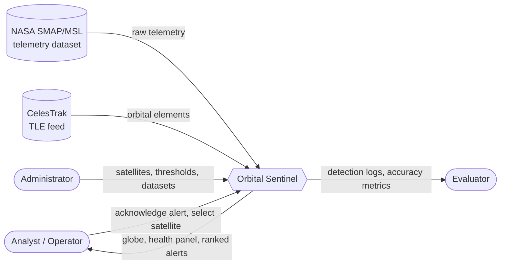
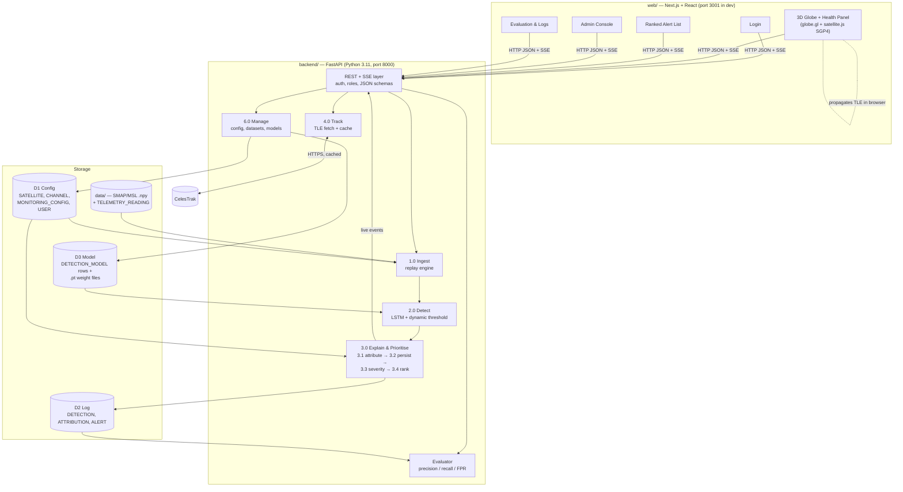
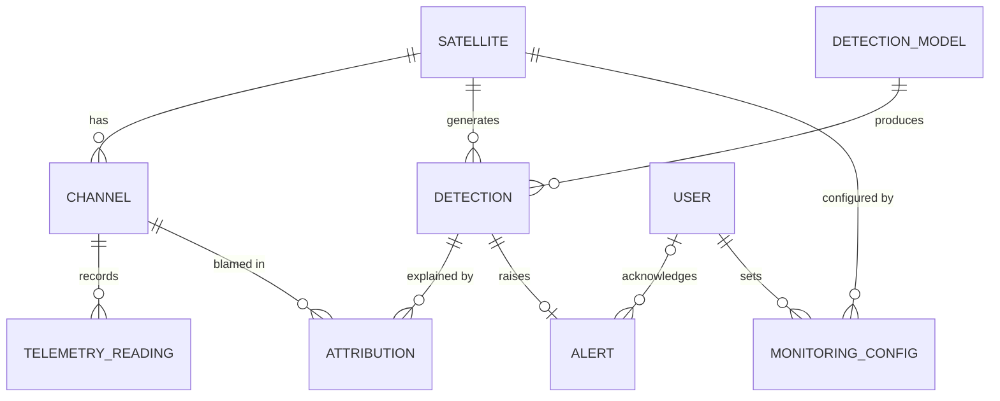
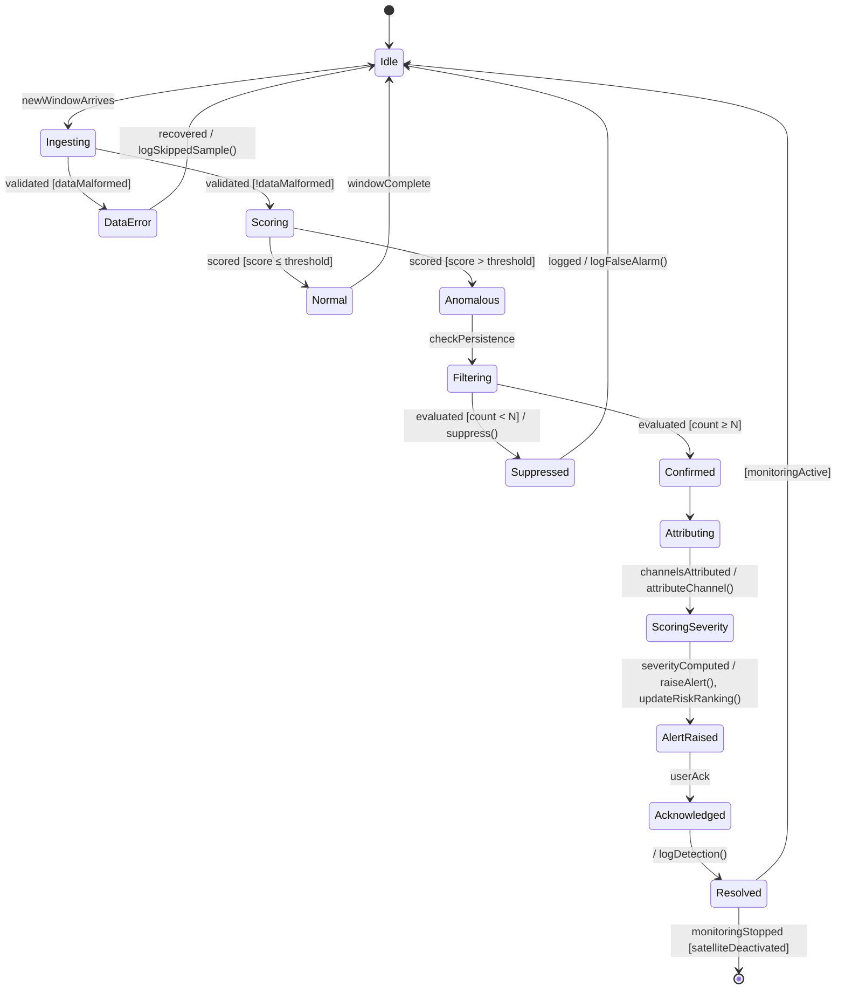
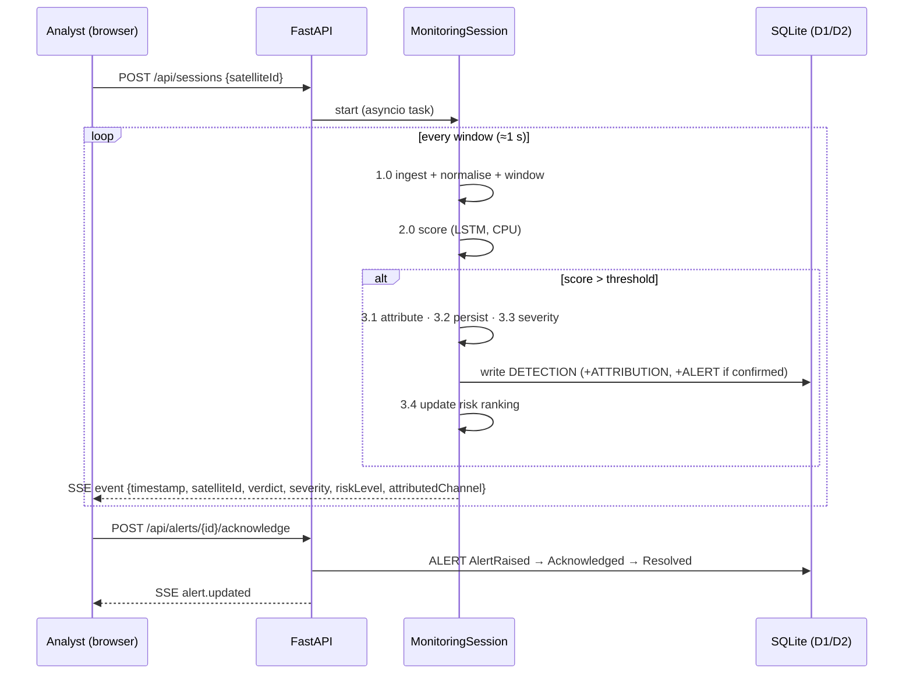

# Orbital Sentinel — System Architecture

> Early-warning health monitoring for satellite fleets: telemetry anomaly detection, explanation and risk ranking, shown on a live 3D globe.

**Status:** v1.0 design, derived from the course documents in this folder. Read it alongside [PHASES.md](PHASES.md), which turns it into a build plan.

**Sources of truth.** Every component below traces back to one of these documents:

| Doc | What it fixes |
|---|---|
| `srs.pdf` (Exp 1, IEEE 830) | REQ-1 … REQ-18, non-functional requirements, user roles, TBD-1/2/3, the Incremental + Prototype-spike process |
| `DFD_level_0_1_and_2.pdf` (Exp 3) | Processes 1.0–6.0, sub-processes 3.1–3.4, data stores D1 Config / D2 Log / D3 Model |
| `ER_diagram.docx` (Exp 4) | Entities and attributes: SATELLITE, CHANNEL, TELEMETRY_READING, DETECTION_MODEL, DETECTION, ATTRIBUTION, ALERT, USER, MONITORING_CONFIG |
| `state_transition_diagram.docx` (Exp 5) | The 14-state detection lifecycle and its 19 transitions, events and guards |

**Naming rule.** Code uses the exact entity names from the ER diagram (`Satellite`, `Detection`, `Alert` …) and the exact state names from the state diagram (`AlertRaised`, `Acknowledged` …). Database columns stay in `snake_case`, as in the ER diagram. JSON uses `camelCase`. Don't rename anything without updating this document.

---

## 1. System context



This matches the Level-0 DFD exactly: three human actors, two external data sources, and one system.

**What the system is (and isn't).** This statement must appear in the README and in the app (SRS §5.2 and §6):
- It **detects anomalies** as they unfold. It does **not** forecast failures.
- Health telemetry is a **historical replay** of public NASA data. Only orbital positions are live.
- It is a **proof of concept** for decision support, not an operational monitoring tool.

---

## 2. Architecture at a glance

There are two independent data paths, and they meet only at the dashboard (SRS Fig. B.1, Level-1 DFD):

- **Health path:** Telemetry dataset → **1.0 Ingest** → **2.0 Detect** → **3.0 Explain & Prioritise** → **5.0 Visualise**
- **Position path:** TLE feed → **4.0 Track** → **5.0 Visualise**
- **6.0 Manage** reads and writes the configuration (D1). The pipeline reads D1 and D3 and writes D2.



### Key design decisions

| # | Decision | Why (source) |
|---|---|---|
| AD-1 | **Python FastAPI backend** for ingestion, ML, explanation and the API | SRS §2.4 requires Python 3.10+ with PyTorch/TensorFlow; keeping ML and API in one process keeps the 1 s latency target simple |
| AD-2 | **Next.js + React frontend**, carried over from the Exp 9 skeleton | Your existing stack; the Selenium/JMeter suites already target it |
| AD-3 | **SQLite by default** (SQLAlchemy + Alembic), Postgres/Supabase via `DATABASE_URL` | SRS §2.4 asks for a *local* database and offline analysis; Supabase stays an optional swap, not a dependency |
| AD-4 | **PyTorch** as the ML framework | Either framework meets the SRS; PyTorch is simpler for small custom LSTMs |
| AD-5 | **TLE propagation in the browser** with satellite.js; the backend only fetches and caches TLEs | SRS §3.3 names satellite.js; this gives smooth per-second position updates (REQ-13) without server load |
| AD-6 | **Server-Sent Events** (`/api/stream`) for live health updates, REST for everything else | One-way push is all that's needed for the ≤ 1 s update target (§5.1); simpler than WebSockets |
| AD-7 | Each **pipeline stage is a pure Python module behind an interface**, wired by an orchestrator | SRS §5.4: stages talk only through defined interfaces and can be tested with mock data |
| AD-8 | **Next.js rewrites `/api/*` → FastAPI** | Keeps the URLs the Exp 9 Selenium/JMeter tests already use; no CORS needed in the browser |

---

## 3. Repository layout (target)

```
Orbital_sentinel/
├── docs/                     SRS, DFD, ER, state diagram, ARCHITECTURE.md, PHASES.md, adr/
├── web/                      Next.js app (moved here from the repo root in Phase 0)
│   ├── app/                  routes: login, globe, alerts, satellites/[id], admin, evaluation
│   ├── components/           Globe, HealthPanel, TelemetryChart, AlertTable, RiskBadge, HelpPanel
│   └── lib/                  entities.ts (ER types), api.ts (typed client), sgp4.ts
├── backend/
│   ├── app/
│   │   ├── api/              routers: auth, satellites, alerts, detections, telemetry, tle, admin, evaluation, stream
│   │   ├── core/             settings, security (roles), db session
│   │   ├── models/           SQLAlchemy ORM — one class per ER entity
│   │   ├── schemas/          Pydantic request/response models (camelCase JSON)
│   │   ├── pipeline/
│   │   │   ├── ingest.py         1.0  ReplaySource, Normaliser, Windower
│   │   │   ├── detect.py         2.0  Detector interface + LstmDetector, DynamicThreshold
│   │   │   ├── explain/          3.0  attribution.py, persistence.py, severity.py, ranking.py
│   │   │   ├── lifecycle.py      Exp 5 state machine (DetectionLifecycle)
│   │   │   └── orchestrator.py   MonitoringSession — wires 1.0 → 2.0 → 3.0
│   │   ├── tracking/         4.0  CelesTrak client + TLE cache
│   │   └── evaluation/       metrics.py, reports.py (REQ-5, REQ-11)
│   ├── alembic/              database migrations
│   └── tests/                unit / integration / accuracy
├── ml/
│   ├── spike/                Increment 0 notebooks (throwaway — the winner moves into backend/)
│   └── train.py              offline training CLI → writes to D3
├── data/                     (gitignored) SMAP/MSL .npy files + labeled_anomalies.csv
├── models/                   (gitignored) trained weights, one folder per DETECTION_MODEL
└── testing/                  Selenium IDE .side, JMeter .jmx, test case tables
```

---

## 4. Data model

### 4.1 Entities (from the ER diagram)



| Entity | ER attributes (kept as-is) | Implementation additions (and why) |
|---|---|---|
| **SATELLITE** | satellite_id, name, norad_id, orbital_elements (tle_line1, tle_line2), mission_tag *(multivalued)*, current_status, current_risk_level *(derived)* | `telemetry_source`, `is_proxy`, `tle_fetched_at` (see §4.3). mission_tag becomes a child table **SATELLITE_MISSION_TAG** (1NF). current_risk_level is computed from open alerts, never stored. |
| **CHANNEL** | channel_id, satellite_id, channel_name, unit, description | `dataset_chan_id` (e.g. `P-1`, `T-1`) and `spacecraft` (`SMAP`/`MSL`) to link to the dataset files |
| **TELEMETRY_READING** | reading_id, channel_id, timestamp, value | `split` (`train`/`test`) and `is_labeled_anomaly` (ground truth for evaluation, REQ-5) |
| **DETECTION_MODEL** | model_id, model_name, model_type, threshold, trained_at | `artifact_path` (D3 weights folder) and `hyperparams` (JSON) |
| **DETECTION** | detection_id, satellite_id, model_id, timestamp, anomaly_score, is_anomaly *(derived)*, severity_level *(derived)*, persistence_count | `window_start`, `window_end`, and `outcome` ∈ {`Suppressed`, `Confirmed`} (REQ-18 "outcome") |
| **ATTRIBUTION** | attribution_id, detection_id, channel_id, contribution_score | — |
| **ALERT** | alert_id, detection_id, risk_level, created_at, acknowledged_by | `status` ∈ {`AlertRaised`, `Acknowledged`, `Resolved`} (Exp 5 states), `acknowledged_at`, `resolved_at` |
| **USER** | user_id, name (first_name, last_name), role, contact_email *(multivalued)* | `password_hash`. contact_email becomes child table **USER_CONTACT_EMAIL** (1NF). role ∈ {`Analyst`, `Administrator`, `Evaluator`} |
| **MONITORING_CONFIG** | config_id, satellite_id, set_by_user_id, persistence_threshold, severity_threshold, updated_at | `is_active` (only the newest row per satellite applies; older rows are kept as history) |

**Derived attributes are computed, not stored** (as the ER doc says): `is_anomaly = anomaly_score ≥ model.threshold`; `severity_level = f(anomaly_score, persistence_count)` (§6.3); `current_risk_level = max(risk_level of non-resolved alerts)`. For speed, DETECTION may cache `severity_level` at write time, because the inputs never change once written.

**What gets logged (REQ-18).** Normal windows are not written row by row. They would swamp D2 and add nothing to the analysis. Every window that crosses the threshold is written as a DETECTION, with `outcome = Suppressed` or `Confirmed`. Per-session counters record how many windows were normal and how many were dropped as malformed. That is enough to compute window-level false-positive rates.

### 4.2 Data stores (DFD) → physical storage

| DFD store | Holds | Physical form |
|---|---|---|
| D1 Config | SATELLITE, CHANNEL, MONITORING_CONFIG, USER | SQL tables |
| D2 Log | DETECTION, ATTRIBUTION, ALERT, session counters | SQL tables |
| D3 Model | DETECTION_MODEL rows + per-channel weights + normalisation stats | SQL table + `models/<model_id>/` folder |
| (input) Telemetry dataset | SMAP/MSL `.npy` + `labeled_anomalies.csv` | `data/` folder, imported into TELEMETRY_READING by the Admin |

### 4.3 Mapping the dataset onto satellites (resolves TBD-2)

The NASA dataset covers exactly **two** spacecraft: **SMAP**, which is in Earth orbit (NORAD 40376), and **MSL** (Curiosity), which is on Mars and has no Earth TLE. To keep this honest:

- **SMAP** is shown at its **real** orbital position and replays the **real** SMAP channels. `is_proxy = false`.
- To populate a fleet, 4–6 additional Earth-orbiting satellites from the CelesTrak feed (e.g. Aqua, Terra, Landsat 9, Sentinel-2A) each get a **disjoint subset of SMAP/MSL channels** as a *replay profile*. `is_proxy = true`, and `telemetry_source` names the channels. Each subset must contain at least one labelled anomaly, so every satellite has something to detect.
- The UI shows a **"Replayed telemetry"** badge on every proxy satellite, and the health panel names the source channels. This is the honest-framing requirement from SRS §2.7 and §6.

---

## 5. Pipeline components (processes 1.0 – 6.0)

All stages implement small typed interfaces (Python `Protocol`s), so each can be swapped or tested with mock data (SRS §5.4).

```python
class TelemetrySource(Protocol):     # 1.0
    def windows(self, satellite_id: str) -> Iterator[TelemetryWindow]: ...

class Detector(Protocol):            # 2.0
    def score(self, window: TelemetryWindow) -> ChannelScores: ...   # per-channel scores + satellite score

class Explainer(Protocol):           # 3.0
    def process(self, scores: ChannelScores, state: SatelliteState) -> ExplainResult: ...
```

### 5.1 Process 1.0 — Ingest (REQ-1, REQ-2, REQ-6)

- **Dataset import (Admin).** A script downloads the Telemanom release (`data.zip` + `labeled_anomalies.csv`) into `data/`. The Admin then imports it, which fills CHANNEL and TELEMETRY_READING and marks ground-truth anomaly ranges.
- **Dataset format to expect.** One `train/<chan>.npy` and one `test/<chan>.npy` per channel. Column 0 is the telemetry value; the remaining columns are one-hot command flags. `labeled_anomalies.csv` lists each channel's anomaly index ranges.
- **ReplaySource.** Streams each satellite's `test` split in time order, at a configurable speed (default: 1 window per second per satellite), with stepped timestamps so replay looks like a live feed.
- **Normaliser.** Scales each channel using statistics fitted on the **train** split only, stored with the model in D3. This avoids test-set leakage.
- **Windower.** Fixed-length sliding windows (history length `l_s`, step `s`); the values are set by the spike in Phase 1.
- **Malformed data (REQ-6).** NaN, ±inf or out-of-range values are interpolated linearly when the gap is ≤ k samples, and the window is skipped otherwise. Either way it is counted and logged, and the session never terminates. This is the `Ingesting → DataError → Idle` path in Exp 5.

### 5.2 Process 2.0 — Detect (REQ-3, REQ-4, REQ-5)

- **Baseline (REQ-3):** a Telemanom-style **LSTM predictor per channel** (Hundman et al., 2018). It predicts the next values from the history window; the prediction error is smoothed (EWMA) and compared against a **non-parametric dynamic threshold**.
  - Settings chosen by the Phase 1 spike ([ADR 001](adr/001-detector-choice.md)): 100 steps of history (the paper uses 250), 10-step prediction horizon, 2 LSTM layers × 80 units, dropout 0.3, EWMA span 105. The threshold decides in batches of 70 points over the previous 2,100.
- **Channel score:** the channel's smoothed error divided by its dynamic threshold, so `score > 1` means anomalous.
- **Satellite score:** the maximum channel score across the satellite's channels. It is stored as `DETECTION.anomaly_score`, and `DETECTION_MODEL.threshold` holds the global decision threshold (REQ-4).
- **Evaluation (REQ-5):** the evaluator compares predicted anomaly ranges with labelled ranges and reports precision, recall, F1 and false-positive rate. It uses the paper's convention: a labelled sequence counts as detected if any predicted range overlaps it. It also reports window-level FPR for REQ-11.
- **Training runs offline** (`ml/train.py`) and writes a new DETECTION_MODEL plus its weights. The live pipeline only runs inference, on CPU.

### 5.3 Process 3.0 — Explain & Prioritise (REQ-7 … REQ-11) — *the novelty layer*

This follows the Level-2 DFD order exactly:

| Sub-process | Logic | Writes |
|---|---|---|
| **3.1 Attribute to channel** (REQ-7) | Rank the satellite's channels by their share of the anomaly: `contribution = channel_score / Σ channel_scores` over the channels above threshold. The top contributors become ATTRIBUTION rows. If no channel stands out, record `unknown` (Exp 5 assumption 6). The method is **error-ranking**, chosen in the spike ([ADR 002](adr/002-attribution-method.md), TBD-3 closed). | ATTRIBUTION |
| **3.2 Persistence filter** (REQ-8) | Count consecutive anomalous windows per satellite. If the count is below N (`MONITORING_CONFIG.persistence_threshold`), the window is `Suppressed` and logged as a false alarm. Otherwise it is `Confirmed`. | DETECTION (outcome) |
| **3.3 Severity score** (REQ-9) | `severity_index = norm(score) × g(persistence_count)`, where `norm(score)` ramps from 0 at the threshold to 1 at 3× the threshold and `g(persistence_count)` ramps from 0 to 1 over 5 consecutive confirmed windows (so a detection needs to be both strong and sustained to read as severe). `severity_threshold` (`MONITORING_CONFIG`) is a per-satellite sensitivity knob the index is divided by before banding into LOW/MEDIUM/HIGH/CRITICAL and `risk_level` 1–10 ([`app/pipeline/explain/severity.py`](../backend/app/pipeline/explain/severity.py)). | DETECTION.severity_level, ALERT.risk_level |
| **3.4 Risk ranking** (REQ-10) | Satellites are ordered by current severity, then risk_level, then most recent detection, via `GET /api/ranking`. Push over SSE is added in Phase 4. | (derived) |

**REQ-11.** The evaluator runs the same replay twice, with and without 3.2, and reports FPR, precision and recall for both side by side. This is the project's main measurable result.

**One alert per anomaly episode.** The first `Confirmed` window of an episode raises an ALERT, linked to that DETECTION (1:1, as in the ER). Later confirmed windows in the same episode **escalate** that open alert (risk_level rises if severity rises) instead of creating duplicates. The episode ends after N consecutive normal windows.

### 5.4 Detection lifecycle (Exp 5 state machine)

`pipeline/lifecycle.py` implements the state diagram as an explicit state machine. There is one instance per window (Exp 5, assumption 1), and every transition is logged for debugging.



**Implementation note.** `userAck` is a human action and can take minutes, so the window pipeline must not wait for it. The engine runs the machine up to `AlertRaised`, then hands off. From there the **ALERT row's `status`** carries `AlertRaised → Acknowledged → Resolved`, driven by the acknowledge API. The per-window machine then returns to `Idle`. The semantics and state names are unchanged; only the waiting is decoupled.

### 5.5 Process 4.0 — Track (REQ-12)

- The backend fetches TLEs from CelesTrak's GP API (`https://celestrak.org/NORAD/elements/gp.php?CATNR=<norad>&FORMAT=tle`) for the monitored satellites. The results are cached in SATELLITE (`tle_line1/2`, `tle_fetched_at`) and refreshed **at most every 2 hours**, per CelesTrak's usage guidance.
- If the fetch fails, the last cached TLE is served, flagged as stale. The globe still works offline.
- `GET /api/tle` returns `{satelliteId, noradId, tleLine1, tleLine2, fetchedAt}`. The browser propagates positions with satellite.js (SGP4) every second (REQ-13).

### 5.6 Process 5.0 — Visualise (REQ-13 … REQ-17)

| View | Route | Requirements |
|---|---|---|
| **Globe** | `/globe` | 3D Earth (globe.gl / three.js) showing satellites at live SGP4 positions with orbit trails, coloured by risk (green/amber/red/critical red, REQ-14). Clicking a satellite opens the health panel (REQ-15). |
| **Health panel** | drawer on `/globe`, full page at `/satellites/[id]` | Verdict, severity/confidence, the attributed channel, and telemetry plots with anomalous ranges shaded (REQ-17), downsampled server-side to ~2,000 points. A "Replayed telemetry" badge appears on proxies. |
| **Alert list** | `/alerts` | Risk-ordered list showing verdict, severity and attributed channel (REQ-16), with an acknowledge action. Live via SSE; drill-down to the health panel (REQ-17). |
| **Evaluation** | `/evaluation` | Precision / recall / FPR per model, the with/without-persistence comparison (REQ-11), and a searchable detection log (REQ-18). |
| **Admin** | `/admin` | Monitored satellites, dataset import, model selection, persistence/severity thresholds (MONITORING_CONFIG). |
| **Help** | overlay on every page | Overview panel, globe controls, risk-colour legend, "how to read an explanation", and the disclaimer (SRS §2.6, §5.2). |

UI rules (SRS §3.1): everything fits a laptop screen with no horizontal scrolling, and a busy indicator shows while a monitoring pass is running.

### 5.7 Process 6.0 — Manage

Admin-only: enrol or remove satellites, import the dataset, choose the active DETECTION_MODEL, set MONITORING_CONFIG (each change writes a new row, so the history is kept), and start or stop monitoring sessions.

---

## 6. Runtime behaviour

### 6.1 Monitoring session (happy path)



Every message carries a **timestamp and satelliteId** (SRS §3.4), so the browser can match health data to positions.

### 6.2 Concurrency

Each monitored satellite runs as its own asyncio task inside the FastAPI process. Model inference is small (an LSTM on a CPU), so 6–8 satellites at 1 window/s stay well within the 1 s budget. If profiling shows otherwise, inference moves to a thread pool. No message broker is needed at this scale.

---

## 7. API surface (v1)

All JSON is camelCase. Errors use the form `{error, detail}`. The three Exp 9 endpoints keep their paths and response shapes, so the existing Selenium and JMeter suites keep working.

| Method | Path | Role | Purpose |
|---|---|---|---|
| POST | `/api/login` · `/api/logout` | public | Session cookie (httpOnly, signed) |
| GET | `/api/me` | any | Current user and role |
| GET | `/api/satellites` | any | Satellites with current risk, verdict and proxy flag |
| GET | `/api/satellites/{id}/health` | any | Latest verdict, severity and attribution (health panel) |
| GET | `/api/satellites/{id}/telemetry?channel&from&to` | any | Downsampled series plus anomaly ranges (REQ-17) |
| GET | `/api/alerts` | any | Risk-ranked alerts (REQ-16) |
| POST | `/api/alerts/{id}/acknowledge` | Analyst, Admin | AlertRaised → Acknowledged → Resolved |
| GET | `/api/detections?satelliteId&outcome&page` | any | Detection log (REQ-18) |
| GET | `/api/ranking` | any | Satellite risk ranking (REQ-10) |
| GET | `/api/tle` | any | Cached TLEs (REQ-12) |
| GET | `/api/stream` | any | SSE: `detection`, `alert.created`, `alert.updated`, `ranking` |
| POST | `/api/sessions` · DELETE `/api/sessions/{id}` | Admin | Start / stop monitoring |
| GET/PUT | `/api/admin/config/{satelliteId}` | Admin | MONITORING_CONFIG |
| POST | `/api/admin/datasets/import` | Admin | Import SMAP/MSL into the database |
| GET/PUT | `/api/admin/models` | Admin | List models, choose the active one |
| GET | `/api/evaluation/metrics?modelId&persistence=on\|off` | Evaluator, Admin | REQ-5, REQ-11 |

**Roles (SRS §5.3, §5.5):** Analysts view everything and can acknowledge alerts, but cannot change datasets or settings. Administrators can do everything. Evaluators have read-only access to everything and do no configuration. The role is checked in FastAPI dependencies on every admin route. The Next.js middleware also hides admin pages, but that is for convenience, not security.

---

## 8. Non-functional requirements → how they're met

| NFR (SRS §5) | Mechanism | Verified by |
|---|---|---|
| Score a window and update the panel in ≈1 s | CPU inference, SSE push, no broker | Latency histogram in the backend; JMeter + SSE timing test |
| Smooth globe frame rate | SGP4 in the browser, positions updated at 1 Hz, instanced points | Chrome performance trace at the demo fleet size |
| TLE fetch + propagation in a few seconds | Cached TLEs served locally; CelesTrak refresh in the background | Integration test with CelesTrak mocked |
| Malformed input never crashes a session | §5.1 interpolate/skip, exceptions caught per window | Unit tests with NaN/inf/gap fixtures |
| Admin separated from analyst views | Role dependencies + middleware | API tests per role; Selenium access tests |
| Stages replaceable and testable | Protocol interfaces + mock implementations | Unit tests per stage using mocks only |
| Portable (Win/macOS/Linux) | Pure Python + Node, SQLite, no GPU required | CI matrix (Ubuntu + Windows) |
| Measurable detection quality | Ground-truth labels + evaluator | Accuracy report committed per model |
| Honest capability statement | README, help overlay, proxy badges | Review checklist before the demo |

---

## 9. Testing strategy

| Level | Tooling | Scope |
|---|---|---|
| Unit | pytest | Normaliser, windower, malformed-data handling, threshold, attribution, persistence, severity, ranking, lifecycle transitions (all 19) |
| Integration | pytest + httpx (FastAPI TestClient), SQLite in-memory | API contracts, roles, the session pipeline on a tiny fixture dataset |
| Accuracy | `backend/app/evaluation` CLI | Precision / recall / F1 / FPR per model; with vs without the persistence filter (REQ-5, REQ-11) |
| E2E functional | Selenium IDE suite (Exp 9), optionally Playwright | Login, ranked alerts, acknowledge, role access, globe click → health panel |
| Performance | JMeter (Exp 9 plan, extended) | API throughput and latency; the SSE update-latency target |

---

## 10. Traceability matrix

| Requirement | Component | Phase |
|---|---|---|
| REQ-1 load + replay | `pipeline/ingest.py` ReplaySource | 2 |
| REQ-2 normalise + window | Normaliser, Windower | 2 |
| REQ-3 baseline LSTM + dynamic threshold | `pipeline/detect.py` | 1 (choose) → 2 (build) |
| REQ-4 threshold labelling | Detector + DETECTION_MODEL.threshold | 2 |
| REQ-5 precision / recall / FPR | `evaluation/metrics.py` | 2 |
| REQ-6 malformed data | Ingest + lifecycle DataError | 2 |
| REQ-7 channel attribution | `explain/attribution.py` | 3 |
| REQ-8 persistence filter | `pipeline/lifecycle.py` (live, built in Phase 2) + `evaluation/persistence.py` (offline, for REQ-11) | 2 → 3 |
| REQ-9 severity | `explain/severity.py` | 3 |
| REQ-10 risk ranking | `explain/ranking.py` | 3 |
| REQ-11 FPR with/without filter | `evaluation/reports.py` | 3 |
| REQ-12 TLE + SGP4 | `tracking/`, `web/lib/sgp4.ts` | 5 |
| REQ-13 globe + live motion | `web/components/Globe` | 5 |
| REQ-14 colour by risk | Globe + RiskBadge | 5 |
| REQ-15 click → health panel | Globe + HealthPanel | 5 |
| REQ-16 ranked alert list | `/alerts`, `GET /api/alerts` | 4 |
| REQ-17 drill-down plots | `/satellites/[id]`, TelemetryChart | 4 |
| REQ-18 detection log | DETECTION table, `/evaluation` | 2 (write) → 4 (view) |
| SRS §5.3 / §5.5 roles | `core/security.py`, middleware | 4 |
| SRS §2.6 docs + help | README, HelpPanel | 6 |

---

## 11. Risks and mitigations

| Risk | Impact | Mitigation |
|---|---|---|
| The LSTM doesn't beat a simple baseline on some channels | Weak REQ-3 story | The Phase 1 spike compares candidates first; the novelty layer (REQ-11) is additive and still shows an FPR improvement |
| Training all 82 channels on CPU is slow | Schedule slip | Train only the channels mapped to monitored satellites; cache weights; train overnight; a GPU is optional |
| CelesTrak is unavailable or rate-limited | Globe can't load positions | 2-hour cache, a stale-TLE fallback, and a bundled snapshot TLE file for offline demos |
| MSL has no Earth orbit | Honesty / UX confusion | Proxy mapping with a visible badge (§4.3) |
| Threshold and N tuned on the test split | Inflated metrics | Tune on a held-out slice of each channel's test data; report on the rest |
| SQLite write contention with many sessions | Latency | WAL mode, batched writes per window; Postgres via `DATABASE_URL` if needed |
