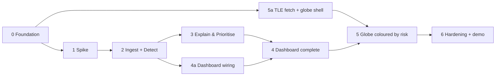

# Orbital Sentinel — Build Phases

This is the build plan for [ARCHITECTURE.md](ARCHITECTURE.md). It follows the process model chosen in the SRS (§4): an **Incremental** build with a **Prototype spike** folded in for the one real unknown, which detector to use. Each phase ends in something that can be demonstrated and tested.

## How phases map to the SRS increments

| Phase | Name | SRS increment | Requirements | Size |
|---|---|---|---|---|
| 0 | Foundation | — (setup) | — | S |
| 1 | Model-selection spike | **Increment 0** | REQ-3 (choice), TBD-3 | M |
| 2 | Ingestion + baseline detection | **Increment 1** | REQ-1 … REQ-6, REQ-18 (write) | L |
| 3 | Explain & prioritise (novelty) | **Increment 2** | REQ-7 … REQ-11, TBD-1 | L |
| 4 | Dashboard & alerting on real data | **Increment 3** (part a) | REQ-16 … REQ-18, SRS §5.3/§5.5 | M |
| 5 | Live orbital tracking + 3D globe | **Increment 3** (part b) | REQ-12 … REQ-15, TBD-2 | M |
| 6 | Hardening, evaluation, docs, demo | — (release) | SRS §2.6, §5, §6 | M |

Sizes are relative effort for one developer: S ≈ a few days, M ≈ 1–2 weeks, L ≈ 2–3 weeks.

**Critical path:** 0 → 1 → 2 → 3 → 4 → 6. The globe (Phase 5) is presentation polish, as the SRS intends. Its tracking half (5a) can be built **in parallel** at any time after Phase 0, so it doesn't block the detection core. Only the colouring by risk waits for Phase 4.

## Rules that apply to every phase

- **Names stay traceable:** ER entity names, Exp 5 state names, and REQ-n tags in test names (e.g. `test_req08_persistence_suppresses_single_spike`).
- **Definition of done** for any task: code + tests passing + the traceability row in ARCHITECTURE.md §10 still true + README updated if behaviour changed.
- **Regression:** the Exp 9 Selenium suite and JMeter plan in `testing/` must still pass at the end of every phase. Update them when endpoints change.
- **Ports:** web runs on **3001** and the API on **8000**. Port 3000 is reserved for another project.
- **Honesty:** never present replayed telemetry as live, and never call a detection a "prediction" or a failure "forecast".

---

## Phase 0 — Foundation

**Goal:** a clean monorepo where the existing Exp 9 app runs against a real Python backend and real database tables, with nothing faked except the data.

### Tasks
**Repo and tooling**
- [x] `git init`, add `.gitignore` (`node_modules`, `.next`, `data/`, `models/`, `*.db`, `.venv`), and make the first commit of the Exp 9 state.
- [x] Move the Next.js app from the repo root into `web/`. Fix the paths in `README.md` and `testing/`.
- [x] Set the web dev port to 3001 (`next dev -p 3001`).
- [x] Create `backend/` with FastAPI, SQLAlchemy 2, Alembic, Pydantic v2, pytest, ruff. Pin versions (`pyproject.toml` or `requirements.txt`).
- [x] Add a CI workflow (GitHub Actions) that runs ruff + pytest for the backend and type-check + build for the web app, on Ubuntu and Windows.

**Data model**
- [x] Write the SQLAlchemy models for all 9 ER entities, plus the child tables SATELLITE_MISSION_TAG and USER_CONTACT_EMAIL, with the additions listed in ARCHITECTURE.md §4.1.
- [x] Create the first Alembic migration. Turn on SQLite WAL mode.
- [x] Write a seed script: 3 users (one per role), the SMAP satellite, and a default MONITORING_CONFIG.

**API skeleton**
- [x] Port the three Exp 9 endpoints (`POST /api/login`, `GET /api/alerts`, `POST /api/alerts/{id}/acknowledge`) to FastAPI with the **same response shapes**, backed by the database.
- [x] Add password hashing (argon2/bcrypt), a signed httpOnly session cookie, and `GET /api/me`.
- [x] Add Next.js rewrites `/api/*` → `http://localhost:8000/api/*`. Delete the mock `lib/store.ts` and the API routes from the web app.

**Dataset access**
- [x] Write `scripts/get_data.(sh|ps1)` to download the Telemanom `data.zip` and `labeled_anomalies.csv` into `data/`.
- [x] Write a small loader that lists the channels, the train/test shapes, and the labelled anomaly ranges. Sanity-check that the channel count and anomaly count match the paper.

### Deliverables
Monorepo layout, database schema + migration, FastAPI serving the Exp 9 endpoints, CI green, dataset on disk.

### Status — done (2026-10-05)
- Verified: 22 backend tests pass, lint clean, web type-check and build pass, login → alerts → acknowledge → logout work end to end through port 3001 against SQLite, and the Exp 9 JMeter plan ran 1,500 requests with 0 errors.
- Not yet verified: the CI workflow has not run (nothing has been pushed), and the Selenium IDE suite needs a manual rerun on port 3001.
- Changes from the plan: the dataset comes from the Kaggle mirror (the original S3 link is closed). Acknowledge sets `Acknowledged`; the `Resolved` step arrives with the episode logic in Phase 3. The API endpoints now require login, so the session cookie is httpOnly and the web app treats a 401 response as "not logged in" instead of reading the cookie.
- Dataset facts: 82 channel files, 81 labelled (54 SMAP, 27 MSL), 104 anomaly sequences after merging the duplicate `P-2` row; `T-10` has no labels.

### Exit criteria
- `npm run dev` (web, port 3001) + `uvicorn` (API, port 8000): login and acknowledge work end to end against SQLite.
- The Exp 9 Selenium suite and JMeter plan pass with only URL or port changes.
- `alembic upgrade head` on a fresh machine creates every ER table.

---

## Phase 1 — Model-selection spike *(SRS Increment 0, Prototype)*

**Goal:** settle the project's single technical unknown, *which detector configuration works best on SMAP/MSL*, before committing the design. The spike code is **throwaway**. Only the decision and the chosen settings move on.

### Tasks
- [x] Pick a representative slice: about 10–15 channels from both SMAP and MSL, covering point and contextual anomalies, including the channels you plan to map to satellites.
- [x] Shared harness (in `ml/spike/`): one shared normalisation, one windowing scheme, and one evaluator (event-level precision/recall/F1 with the overlap rule, plus window-level FPR).
- [x] **Candidate A:** Telemanom-style LSTM predictor + EWMA smoothing + non-parametric dynamic threshold (the SRS baseline).
- [x] **Candidate B:** LSTM autoencoder (reconstruction error) + a static percentile threshold.
- [x] **Floor:** a rolling z-score or Isolation Forest, to prove the LSTMs earn their complexity.
- [x] Sweep the key hyperparameters (history length `l_s`, hidden size, smoothing window, threshold percentile). Record CPU training time per channel.
- [x] **TBD-3:** on the winning model, compare *error-ranking attribution* with a *SHAP-style* attribution on a few labelled multi-channel anomalies. Choose one, weighing faithfulness against cost.
- [x] Write `docs/adr/001-detector-choice.md` and `docs/adr/002-attribution-method.md`, with results tables and the go/no-go decision.

### Deliverables
Two ADRs, a results table (per-candidate P/R/F1/FPR and training time), and frozen starting hyperparameters for Phase 2.

### Status — done (2026-10-05)
- **Decision: go.** Per-channel LSTM predictor (100 steps of history, 2 × 80 units) with the paper's dynamic threshold. On 12 held-out channels: precision 0.94, recall 0.68, F1 0.79, 3.0% of normal points flagged, about 36 s of CPU training per channel. Best autoencoder: F1 0.65. Best floor: F1 0.51.
- **TBD-3 closed:** attribution by error ranking, which named the faulty channel for 15 of 17 anomalies (SHAP-style: 7 of 17).
- **Carry forward:** the F1 above is optimistic, because the final variant was chosen using the held-out channels (the 4 tuning channels turned out too few to choose on). Phase 2 re-measures on all 81 labelled channels. The EWMA span is re-tuned in Phase 3.
- Changes from the plan: 16 channels (4 tuning + 12 held-out) instead of 10–15; scripts instead of notebooks; no hidden-size sweep beyond 40/80.
- Records: [ADR 001](adr/001-detector-choice.md), [ADR 002](adr/002-attribution-method.md), [results tables](results/phase1_spike.md).

### Exit criteria
- A **go** decision: the chosen detector beats the floor on F1 on the slice, and training the monitored channels on CPU fits overnight.
- TBD-3 is closed in the ADR.
- **Time-box:** about 1–1.5 weeks maximum. If no candidate clearly wins, take Candidate A (the SRS baseline) and move on. The novelty layer doesn't depend on beating a number (SRS §4.2).

---

## Phase 2 — Ingestion + baseline detection *(SRS Increment 1)*

**Goal:** a working detection core. It replays real telemetry, scores it with the chosen model, logs detections, and reports real accuracy numbers.

### Status — code complete, baseline report pending (2026-10-11)
- Pipeline built and tested: `ingest.py` (ReplaySource, Normaliser, Windower, REQ-6 gap repair), `lstm.py` + `train.py` (the Phase 1 ADR-001 model, resumable training CLI), `detect.py` (StreamingThreshold — an incremental version of the spike's dynamic threshold, decided in 70-point steps and never revising a committed decision), `lifecycle.py` (all 19 transitions), `session.py` (MonitoringSession orchestrator), `app/evaluation/` (metrics + the baseline report CLI), `/api/sessions`, `/api/detections`, and a `/evaluation` page. 127 backend tests pass (103 before this status + the ones added with it), lint is clean, the web app builds.
- **Verified end to end** on the one channel trained so far (A-1): a real `MonitoringSession` replayed SMAP's test split through the real `LstmDetector` and wrote through to the real database via the FastAPI-shaped code path (`app/api/detections` reads it back).
- **Training is still running.** 1 of 81 channels done; the laptop has been running roughly 10-20x slower than the Phase 1 benchmark. The cause: a Selenium IDE window left open since 23 Sept (Exp 9) had accumulated about 90 hours of CPU time and was still active, alongside several Chrome windows — not a bug in this phase's code. Resolving that and re-running `python -m app.pipeline.train` (resumable; already-trained channels are skipped) is the remaining step before the baseline report can be generated.
- **A genuine limitation found while verifying A-1, inherited from the Phase 1 spike, not introduced here:** `decide_window()`'s absolute `errors.max() <= 0.05` guard (same line in `ml/spike/common.py`) assumes error scales like the Phase 1 sample channels. On a channel whose EWMA-smoothed errors never exceed 0.05 in absolute terms, no window can ever be flagged, regardless of how large the error is relative to that channel's own normal level — A-1's smoothed error peaked at 0.044 against a labelled anomaly, so it was missed entirely. This wasn't caught in Phase 1 because none of its 16 sampled channels happened to have such a low error scale. Left as-is for Phase 2 (faithful to the validated ADR-001 algorithm); flagged for Phase 3's threshold tuning (TBD-1), where a per-channel relative guard (e.g. relative to that channel's own training-error statistics, already computed and stored) should replace the fixed constant.
- **Window-scoring time was not cleanly verified against the <1s exit criterion**: measured 857ms-1972ms per window on A-1 while training (and the stuck Selenium IDE) were competing for the same CPU. That is not a trustworthy measurement of the pipeline's real cost and needs re-measuring on an idle machine.
- Also fixed in this phase: a correctness bug in the new streaming threshold's buffering step (`_buffer`) that used `np.convolve(mode="same")`, which does not reliably return the input's length when the kernel is longer — caught by a unit test before anything shipped, not by production use.

### Tasks
**1.0 Ingest (REQ-1, REQ-2, REQ-6)**
- [x] Admin dataset import: `data/` → CHANNEL + TELEMETRY_READING (with `split` and `is_labeled_anomaly`). Make it idempotent.
- [x] `ReplaySource`: time-ordered stream per satellite with a configurable speed.
- [x] `Normaliser`: fitted on train only, statistics stored in D3 with the model.
- [x] `Windower`: history length and step from the Phase 1 ADR.
- [x] Malformed-data handling: interpolate short gaps, skip long ones, count and log them. Test with NaN, inf and gap fixtures, and confirm the session never stops.

**2.0 Detect (REQ-3, REQ-4)**
- [x] Move the winning model from `ml/spike/` into `backend/app/pipeline/detect.py` behind the `Detector` protocol.
- [x] `ml/train.py`: train the per-channel models for the monitored channels → `models/<model_id>/` + a DETECTION_MODEL row (threshold, hyperparameters, trained_at).
- [x] Channel score and satellite score as defined in ARCHITECTURE.md §5.2; threshold labelling (REQ-4).

**Lifecycle + logging (Exp 5, REQ-18)**
- [x] `pipeline/lifecycle.py`: the state machine with all 14 states and 19 transitions. In this phase the persistence filter is a pass-through (N = 1); it becomes real in Phase 3.
- [x] Unit test **every transition** and guard.
- [x] `MonitoringSession` orchestrator (asyncio task per satellite); `POST/DELETE /api/sessions`.
- [x] Write a DETECTION for every above-threshold window; keep per-session counters for normal and malformed windows.

**Evaluation (REQ-5)**
- [x] `evaluation/metrics.py`: precision, recall, F1, FPR against the labels. Write a CLI that emits a Markdown/JSON report per model.
- [ ] Commit the first baseline accuracy report to `docs/results/`.

**Minimal UI hook**
- [x] `GET /api/detections`, plus a simple `/evaluation` page listing detections and the metrics.

### Deliverables
Replay → detect → log pipeline, trained baseline models, and a baseline accuracy report.

### Exit criteria
- Starting a session for SMAP streams windows and writes DETECTIONs; malformed fixtures never crash it.
- The accuracy report reproduces the spike's numbers within a reasonable margin.
- Window scoring takes **< 1 s** per satellite (log the timings).

---

## Phase 3 — Explain & prioritise *(SRS Increment 2 — the novelty)*

**Goal:** turn raw detections into explained, de-noised, ranked alerts, and **measure the improvement** over the baseline.

### Tasks
**3.1 Attribute (REQ-7)**
- [ ] Implement the attribution method chosen in ADR-002. Write ATTRIBUTION rows (top-k channels with `contribution_score`); handle `unknown`.
- [ ] Test: on labelled single-channel anomalies, the top attributed channel is the labelled one (record the hit rate).

**3.2 Persistence filter (REQ-8)**
- [ ] Consecutive-window counter per satellite, with N from MONITORING_CONFIG. Outcome `Suppressed` (logged as a false alarm) or `Confirmed`.

**3.3 Severity (REQ-9)**
- [ ] `severity_index = norm(score) × g(persistence)` → LOW/MEDIUM/HIGH/CRITICAL bands from `severity_threshold`, and `risk_level` 1–10.

**3.4 Risk ranking (REQ-10)**
- [ ] Ranking ordered by severity, then risk_level, then recency. Expose `GET /api/ranking`.

**Alerts**
- [ ] Raise an ALERT on the first `Confirmed` window of an episode. Later windows escalate the open alert. The episode ends after N normal windows.
- [ ] Alert status flow `AlertRaised → Acknowledged → Resolved` via the acknowledge API.

**Tuning + measurement (TBD-1, REQ-11)**
- [ ] Split each channel's test data into a **tuning slice** and a **reporting slice**.
- [ ] Sweep N and the severity bands on the tuning slice; pick the values; close **TBD-1** in `docs/adr/003-thresholds.md`.
- [ ] `evaluation/reports.py`: run the reporting slice **with and without** the persistence filter; report FPR, precision and recall side by side. Commit to `docs/results/`.

### Deliverables
Explained, ranked alerts in the database, ADR-003, and the **baseline-vs-enhanced comparison report**, the project's headline result.

### Exit criteria
- The FPR with the filter is measurably lower than without it on the reporting slice, and the recall cost is stated honestly.
- Every Confirmed detection has at least one ATTRIBUTION or an explicit `unknown`.
- `GET /api/alerts` returns real, risk-ranked alerts produced by a replay.

---

## Phase 4 — Dashboard & alerting on real data *(SRS Increment 3, part a)*

**Goal:** the analyst can work the system end to end in the browser on live (replayed) data, with roles enforced.

**Can start early:** the wiring tasks (4a) can begin once Phase 2 is done, because the API shapes are already fixed.

### Tasks
**Live data**
- [ ] `GET /api/stream` (SSE): `detection`, `alert.created`, `alert.updated`, `ranking` events, each with a timestamp and satelliteId.
- [ ] Web: a typed API client (`web/lib/api.ts`) and a `useStream()` hook with auto-reconnect.

**Views**
- [ ] `/alerts`: risk-ordered list showing verdict, severity, attributed channel and status; acknowledge; live updates (REQ-16). Keep the Exp 9 element IDs so the Selenium suite still works.
- [ ] `/satellites/[id]`: health panel with telemetry plots (Recharts), anomaly ranges shaded, and the attributed channel highlighted (REQ-17). Add `GET /api/satellites/{id}/telemetry` with server-side downsampling.
- [ ] `/evaluation`: metrics, the with/without-filter comparison, and a paginated, filterable detection log (REQ-18).
- [ ] `/admin`: satellites, dataset import, active model, MONITORING_CONFIG editor (history kept), start/stop sessions.
- [ ] A busy indicator while sessions run; layouts that fit a laptop screen (SRS §3.1).

**Roles (SRS §5.3, §5.5)**
- [ ] FastAPI role dependencies: Analyst = view + acknowledge; Admin = everything; Evaluator = read-only.
- [ ] Next.js middleware: redirect when not logged in; hide admin pages from non-admins.
- [ ] API tests per role on every admin route (expect 403).

**Tests**
- [ ] Extend the Selenium suite: role access, drill-down from an alert to the health panel, a live alert appearing during a replay.
- [ ] Extend the JMeter plan: telemetry and ranking endpoints; measure SSE update latency.

### Deliverables
A complete analyst, admin and evaluator UI on real pipeline data.

### Exit criteria
- An alert raised by a replay appears in `/alerts` within about 1 s, and drill-down shows the shaded anomaly on the right channel.
- An Analyst account gets 403 on every admin route.
- The Selenium and JMeter suites pass.

---

## Phase 5 — Live orbital tracking + 3D globe *(SRS Increment 3, part b)*

**Goal:** the situational-awareness view, with real positions and health colours.

**5a can run in parallel** with Phases 1–4. Only 5b needs Phase 4.

### Tasks
**5a — Tracking and a plain globe (REQ-12, REQ-13)**
- [ ] **TBD-2:** choose the fleet. Keep SMAP as the real satellite and add 4–6 Earth-orbiting proxies, each with a disjoint channel subset containing at least one labelled anomaly. Record the choice in `docs/adr/004-fleet-and-proxies.md`.
- [ ] `tracking/`: CelesTrak GP client, a TLE cache in SATELLITE (refreshed at most every 2 h), a stale fallback, and a bundled snapshot TLE file for offline demos.
- [ ] `GET /api/tle`.
- [ ] `/globe`: a globe.gl Earth; satellite.js SGP4 propagation at 1 Hz; orbit trails; ground track on hover.

**5b — Health on the globe (REQ-14, REQ-15)**
- [ ] Colour satellites by current risk (green / amber / red / critical); update live from the SSE `ranking` events.
- [ ] Click a satellite to open the health-panel drawer (the same component as `/satellites/[id]`).
- [ ] "Replayed telemetry" badge on proxy satellites; legend for the risk colours.

**Tests**
- [ ] Unit test: SGP4 position for SMAP at a fixed epoch matches a reference (from the satellite.js docs or a known ephemeris) within tolerance.
- [ ] Integration test with CelesTrak mocked: cold-cache load in a few seconds (SRS §5.1).
- [ ] Frame-rate check in the Chrome performance panel at the demo fleet size.
- [ ] Selenium: click a satellite → health panel opens. Use a test hook or a list fallback, because canvas clicks are hard to record.

### Deliverables
A live 3D globe with real positions, health colours and click-to-inspect; ADR-004.

### Exit criteria
- The globe loads in a few seconds, moves smoothly, and colours change within about 1 s of a new alert.
- It works with the network down (cached or snapshot TLEs, marked stale).

---

## Phase 6 — Hardening, evaluation, docs, demo

**Goal:** a reliable, honest, well-documented proof of concept, ready for the end-of-term demo and evaluation.

### Tasks
**Quality**
- [ ] Full regression: unit, integration, accuracy, Selenium, JMeter. Fix anything red.
- [ ] Failure drills: kill the network (globe fallback), feed a corrupt `.npy` (session survives), restart the API mid-session (sessions recover or stop cleanly).
- [ ] Performance pass: profile window latency with all demo satellites running; enable thread-pool inference only if needed.
- [ ] A security pass appropriate to a local proof of concept: admin routes are role-guarded, secrets live in `.env`, and the CORS/rewrite configuration is tight.

**Documentation (SRS §2.6, §5.2, §6)**
- [ ] README + quick-start: install, `get_data`, import, train, run, open the demo.
- [ ] In-app help: overview panel, globe controls, risk-colour meaning, "how to read an explanation".
- [ ] The disclaimer everywhere it's required: anomaly detection, not forecasting; replayed telemetry; proof of concept.
- [ ] Final results document: baseline metrics, enhanced metrics, the FPR improvement (REQ-11), the attribution hit rate, and latency figures.
- [ ] Update ARCHITECTURE.md for anything that changed; finalise the ADRs.

**Demo**
- [ ] A scripted demo scenario: start a replay → a real labelled anomaly is detected → a transient spike is suppressed → an alert appears ranked → drill-down → acknowledge → the evaluation page shows the improvement.
- [ ] A demo-mode switch: faster replay that starts just before a known labelled anomaly, so the story fits in about 5 minutes.
- [ ] A backup recording of the demo.

### Exit criteria
- Every row in the ARCHITECTURE.md §10 traceability matrix has a passing test or a documented result.
- A fresh-clone setup following the README works on a second machine.
- The demo runs end to end twice in a row without manual fixes.

---

## Open decisions and where they close

| ID | Decision | Closed in | Record |
|---|---|---|---|
| TBD-3 | Attribution method (error ranking vs SHAP-style) | Phase 1 | `docs/adr/002-attribution-method.md` |
| — | Detector model + hyperparameters | Phase 1 | `docs/adr/001-detector-choice.md` |
| TBD-1 | Anomaly threshold, persistence N, severity bands | Phase 3 | `docs/adr/003-thresholds.md` |
| TBD-2 | Globe fleet + proxy channel mapping | Phase 5a | `docs/adr/004-fleet-and-proxies.md` |
| — | Optional move from SQLite to Supabase/Postgres | Any phase, only if needed | `docs/adr/005-database.md` |

## Working as a team (optional)

The SRS assumes a single developer. If teammates join, these workstreams split cleanly along the stage interfaces:
- **ML:** Phase 1 → the Phase 2 detector and training → the Phase 3 evaluation reports
- **Backend:** Phase 0 → ingest, lifecycle and orchestrator → explain and alerts → SSE and roles
- **Frontend:** Phase 0 web move → Phase 5a globe (parallel) → Phase 4 views → Phase 5b
- **QA/Docs:** test suites from Phase 0 onward, plus the Phase 6 docs and demo script
