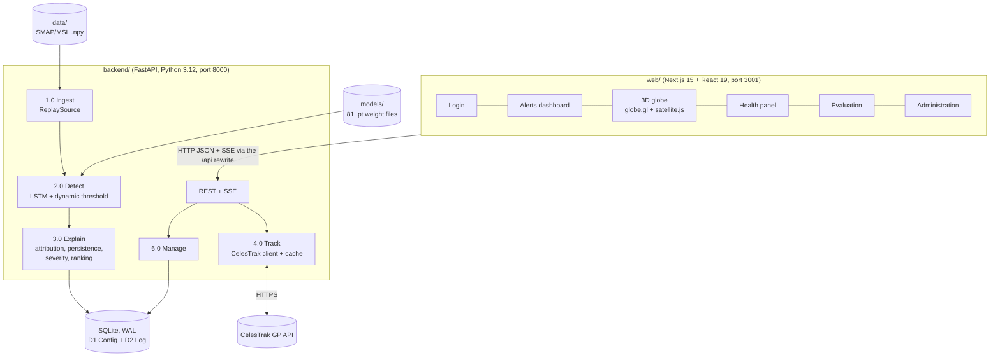

# Orbital Sentinel: Complete Project Guide

> Early-warning health monitoring for satellite fleets: telemetry anomaly detection, explanation and risk ranking, shown on a live 3D globe.

**Prepared:** 21 October 2026, from the repository at commit `5699dbd` (github.com/ItsPM25/Orbital_sentinel).
**Student:** Pushkar Kumar Mishra · Register No. 24BPS1128 · B.Tech CSE (Cyber Physical Systems) · VIT Chennai.
**Course:** Software Engineering Lab, BCSE301P.

---

## 0. How to use this document

This file describes the whole project: what it does, how every part works, what was measured, and what is still pending. It has two readers:

- **An AI assistant writing the final course report.** Everything here is taken from the code, the decision records (ADRs) and the results files in the repository. **Do not invent numbers, dates, screenshots or features.** Anything marked **PENDING** has not been done yet; write it as future work, or leave a placeholder for the student to fill in once it is done. Quote measured numbers together with the conditions they were measured under.
- **The student, preparing to explain the project.** Section 23 has plain-language answers to the questions a professor is likely to ask.

Status labels used below:

| Label | Meaning |
|---|---|
| **DONE** | Built, tested, and in the repository |
| **MEASURED** | A number produced by running the system; the source file is named |
| **PENDING** | Not done yet; see Section 21 |

The companion file `REPORT_PLAN.md` explains how to turn this material into the report (Jira, testing, tools, diagrams).

---

## 1. Course context and timeline of the lab experiments

The project was carried through the whole lab course. Each experiment produced an artefact that the implementation still follows.

| Experiment | Artefact | Date | Where |
|---|---|---|---|
| Exp 1 | SDLC model study + IEEE 830 SRS (REQ-1 … REQ-18) | 14 Jul 2026 | `docs/srs.pdf` |
| Exp 3 | Data Flow Diagrams, levels 0, 1 and 2 | (in the PDF) | `docs/DFD_level_0_1_and_2.pdf` |
| Exp 4 | ER diagram (9 entities) | 4 Aug 2026 | `docs/ER_diagram.docx` |
| Exp 5 | State transition diagram (StarUML, 14 states, 19 transitions) | 19 Aug 2026 | `docs/state_transition_diagram.docx` |
| Exp 9 | Selenium IDE + JMeter testing of a minimal skeleton app | late Sep 2026 | `report/`, `testing/` |
| Project build | Phases 0–5 of `docs/PHASES.md`, plus a UI redesign | 5–20 Oct 2026 | the repository |

**Naming rule used everywhere in the code:** entity names are exactly the ER diagram's (`Satellite`, `Detection`, `Alert` …), alert states are exactly the state diagram's (`AlertRaised`, `Acknowledged`, `Resolved`), and tests are tagged with requirement IDs (e.g. `test_req12_sgp4_smap_position`). This keeps the code traceable to the earlier experiments.

---

## 2. The project in one paragraph

Satellites stream telemetry from thousands of sensor channels, far more than an operator can watch. Orbital Sentinel learns what *normal* telemetry looks like for each channel with a small LSTM neural network. It then replays real NASA telemetry through those models and flags readings that deviate from what the model expected. Each anomaly is attributed to the channel that caused it, filtered so one-off spikes don't raise alarms, given a severity and a 1–10 risk level, and ranked across the fleet. Analysts see a risk-ranked alert list, a health panel with the telemetry chart and the flagged region shaded, and a live 3D globe. The globe shows five real satellites at their actual current positions (computed from public orbital data), coloured by risk; clicking one opens its details. The detector's accuracy is measured against NASA's expert labels: **F1 0.683 over all 81 labelled channels** (MEASURED, Section 12).

### What the system is, and what it is not (required by SRS §5.2 and §6)

- It **detects anomalies** as they unfold. It does **not** forecast or predict failures.
- The health telemetry is a **historical replay** of a public NASA dataset, not a live feed. **Only the orbital positions are live.**
- It is a **proof of concept** for decision support, not an operational monitoring tool.
- Four of the five satellites are **proxies**: real satellites at real positions whose *health* comes from replayed SMAP/MSL channels. The UI says so on every proxy.

---

## 3. Problem statement and motivation (from the SRS)

- Navigation, weather, disaster response, communications and Earth observation all depend on satellites operated by agencies such as ISRO, NASA and ESA. A failing satellite affects those services, and the asset itself is worth hundreds of millions.
- One spacecraft reports thousands of telemetry channels. Operators need automated help to spot early signs of degradation, such as a power channel sagging, a component overheating or a sensor drifting.
- Real operational telemetry is private, so the project uses NASA's publicly released, expert-labelled telemetry from the **SMAP** satellite and the **Curiosity (MSL)** Mars rover. The technique transfers to any sensor-driven system: power grids, industrial machinery, hospital monitoring, data centres.

**Why the problem drove the process model (SRS §1.1):**
- the pipeline layers separate cleanly;
- the requirements are well understood;
- there is exactly one real technical unknown, namely which detector works best;
- there is a hard deadline with a required demo;
- it is a single-developer effort.

---

## 4. Objectives

1. Detect anomalies in spacecraft telemetry with a learned model of normal behaviour, and measure the accuracy against ground-truth labels (REQ-1 … REQ-6).
2. Explain each anomaly by naming the responsible channel, suppress transient false alarms, assign a severity and risk level, and rank satellites by risk (REQ-7 … REQ-11). This is the project's **novelty layer**.
3. Track real satellites live on a 3D globe, coloured by risk, with click-to-inspect (REQ-12 … REQ-15).
4. Give analysts a risk-ranked alert list with drill-down to the telemetry, and log every detection (REQ-16 … REQ-18).
5. Enforce three roles (Analyst, Administrator, Evaluator) and meet the non-functional targets in SRS §5.

---

## 5. Scope and limitations

**In scope:** everything in the SRS, demonstrated on public data on one laptop.

**Out of scope:** integration with any operator's private live telemetry; failure forecasting; multi-user deployment; GPU training.

**Known limitations** (all stated honestly in the docs and the UI):
- Health telemetry is replayed history, and four satellites are proxies (Section 13.1).
- Detection quality is moderate: F1 0.683 overall, with MSL weaker than SMAP (Section 12.2).
- The dynamic threshold has an absolute guard (`errors.max() <= 0.05`). It means channels whose errors are tiny in absolute terms can never be flagged. Channel A-1 is the known example: its anomaly is always missed (Section 21).
- One replay lasts only 28–105 windows per satellite, about 0.5–2 minutes at 1 window/s. Starting a satellite's replay again reproduces the same alerts, because the replay clock always starts at the same synthetic time.

---

## 6. Requirements and their status

### 6.1 Functional requirements (SRS §4)

| ID | Requirement (short) | Status | Where it is implemented |
|---|---|---|---|
| REQ-1 | Load the dataset; replay it as a time-ordered stream per satellite | DONE | `backend/app/pipeline/ingest.py` (`ReplaySource`) |
| REQ-2 | Normalise; segment into fixed windows | DONE | `ingest.py` (`Normaliser`, `Windower`; 100-step history, 70-step windows) |
| REQ-3 | Score each window with a trained baseline (LSTM + dynamic threshold) | DONE | `pipeline/lstm.py`, `pipeline/detect.py` |
| REQ-4 | Label a window anomalous when its score exceeds the threshold | DONE | `detect.py` (`GLOBAL_THRESHOLD = 1.0`; score > 1 means anomalous) |
| REQ-5 | Compute precision, recall and FPR against ground truth | DONE + MEASURED | `evaluation/metrics.py`, `evaluation/baseline.py`, `docs/results/phase2_baseline.md` |
| REQ-6 | Skip or interpolate malformed values without stopping the session | DONE | `ingest.py` (`repair_series`: gaps ≤ 5 samples interpolated, longer gaps skipped) |
| REQ-7 | Attribute each anomaly to the responsible channel(s) | DONE | `pipeline/explain/attribution.py` (error ranking, top 3) |
| REQ-8 | Persistence filter: alert only after N consecutive anomalous windows | DONE | `pipeline/lifecycle.py`; offline copy in `evaluation/persistence.py` |
| REQ-9 | Severity from score and persistence | DONE | `pipeline/explain/severity.py` |
| REQ-10 | Risk ranking of all satellites | DONE | `pipeline/explain/ranking.py`, `GET /api/ranking` |
| REQ-11 | Report FPR with vs without the persistence filter | Code DONE, **results PENDING** | `evaluation/reports.py`; the run has not been done (Section 21) |
| REQ-12 | Fetch public TLEs; compute positions with SGP4 | DONE | `backend/app/tracking/celestrak.py`, `web/lib/sgp4.ts` |
| REQ-13 | 3D globe with positions updated over time | DONE | `web/app/(app)/globe/GlobeCanvas.tsx` |
| REQ-14 | Colour each satellite by risk | DONE | globe + `web/lib/risk.ts` |
| REQ-15 | Selecting a satellite opens its health panel | DONE | globe detail panel; `/satellites/[id]` |
| REQ-16 | Risk-ordered alert list with verdict, severity and channel | DONE | `/dashboard`, `GET /api/alerts` |
| REQ-17 | Drill-down to telemetry plots with the anomaly highlighted | DONE | `/satellites/[id]` (Recharts, shaded ranges) |
| REQ-18 | Log every detection with timestamp, score, channel, severity and outcome | DONE | `DETECTION` + `ATTRIBUTION` tables, `GET /api/detections`, `/evaluation` |

### 6.2 Non-functional requirements (SRS §5) and how each is met

| NFR | Target | Mechanism | Evidence so far |
|---|---|---|---|
| Performance (5.1) | Score a window and update the panel in about 1 s | CPU inference, 2 PyTorch threads per process, SSE push | MEASURED 2026-10-20, SMAP (18 channels): last window 632 ms, slowest 838 ms, on a heavily loaded laptop |
| Performance (5.1) | Smooth globe frame rate | SGP4 in the browser, WebGL, pixel ratio capped at 1.5 | Visually smooth; a formal FPS trace is PENDING |
| Performance (5.1) | Orbits ready within a few seconds of opening the globe | TLE cache (2 h), 5 s fetch timeout, parallel fetch, 10-min failure backoff, bundled snapshot | MEASURED: first `/api/tle` 6.7 s with CelesTrak unreachable, 0.04 s afterwards |
| Safety (5.2) | State that it is not an operational tool | Login page, sidebar note, proxy notices, README | DONE |
| Security (5.3) | Admin functions separated from analyst views | Role checks on every admin API route; client redirect; argon2 password hashes; signed httpOnly cookie | 403 tests in pytest; Selenium TC07 |
| Reliability (5.4) | Malformed input never crashes a session | Gap repair; per-window exception handling; `lastError` reported | pytest ingest tests (NaN, inf, gaps) |
| Maintainability (5.4) | Stages replaceable and testable with mock data | Python `Protocol` interfaces; `ScriptedDetector` test double | 219 backend tests, mostly mock-based |
| Portability (5.4) | Windows, macOS, Linux | Pure Python + Node, SQLite | GitHub Actions matrix (Ubuntu + Windows) is configured; its run status is to be checked on GitHub |
| Testability (5.4) | Measurable detection quality | Ground-truth labels + evaluator CLI | F1 0.683 report |
| Usability (5.4) | Readable without training | Colour = risk only, legend, plain labels, light/dark themes | In-app help overlay PENDING |

### 6.3 User roles (SRS §2.3, §5.5)

| Role | Can do | Seeded account |
|---|---|---|
| Analyst (operator) | View everything; acknowledge alerts | `analyst@orbitalsentinel.test` / `sentinel123` |
| Administrator | Everything: start/stop monitoring, thresholds, dataset import, models | `admin@orbitalsentinel.test` / `admin123` |
| Evaluator | Read-only: results, logs, metrics | `evaluator@orbitalsentinel.test` / `evaluator123` |

### 6.4 SRS open decisions (TBDs), now closed

| TBD | Question | Answer | Record |
|---|---|---|---|
| TBD-1 | Threshold and persistence N | Threshold: dynamic, score > 1. N defaults to 3; the data-driven sweep is PENDING | `docs/adr/003-thresholds.md` (preliminary) |
| TBD-2 | Which satellites on the globe | SMAP + Aqua, Terra, Landsat 9, Sentinel-2A (proxies) | `docs/adr/004-fleet-and-proxies.md` |
| TBD-3 | Attribution method | Error ranking (15/17 correct) over SHAP-style (7/17) | `docs/adr/002-attribution-method.md` |

---

## 7. Software process model

**Chosen in the SRS (Exp 1): an Incremental model with a Prototype spike folded in.** Six models were compared (Waterfall, V-Model, Incremental, Prototype, Spiral, Agile).

The reasons given:
- the pipeline decomposes into increments that can be built and tested independently;
- the requirements are stable;
- an early working demo is needed;
- integration risk is spread across increments;
- the process overhead suits one developer.

The **prototype spike** resolves the one real unknown (which detector to use), and its code is thrown away afterwards.

| SRS increment | Build phase (`docs/PHASES.md`) | Delivered | Date |
|---|---|---|---|
| (setup) | Phase 0: Foundation | Monorepo, FastAPI backend, database schema, dataset download, CI | 5 Oct 2026 |
| Increment 0: Spike | Phase 1: Model-selection spike | Detector comparison; ADR 001 and 002 | 5 Oct 2026 |
| Increment 1 | Phase 2: Ingestion + baseline detection | Replay → LSTM → threshold → lifecycle → log; 81 channels trained; baseline report | code 11 Oct, report 19 Oct |
| Increment 2 | Phase 3: Explain and prioritise | Attribution, persistence filter, severity, ranking, alert episodes | 11 Oct (REQ-11 run PENDING) |
| Increment 3a | Phase 4: Dashboard and alerting | SSE live updates, health panel, admin, evaluation pages, roles | 11 Oct |
| Increment 3b | Phase 5: Orbital tracking + 3D globe | CelesTrak client, SGP4, globe, fleet (ADR 004) | 11–12 Oct |
| (polish) | Performance fixes + UI redesign | Pacing, CPU and globe fixes; shadcn/ui redesign; rebuilt globe | 19–20 Oct |
| Release | Phase 6: Hardening, docs, demo | PENDING | — |

**Jira:** the course requires Jira. It was **not** used during Phases 0–5. `REPORT_PLAN.md` describes how to set it up now: completed work recorded from the plan and the git history, and the remaining work run as real sprints. The report should say this plainly rather than imply Jira was used from day one.

---

## 8. System architecture

### 8.1 Two data paths that meet only at the dashboard

- **Health path:** NASA telemetry files → **1.0 Ingest** → **2.0 Detect** → **3.0 Explain and Prioritise** → database → **5.0 Visualise**
- **Position path:** CelesTrak TLEs → **4.0 Track** → **5.0 Visualise** (the browser computes positions)
- **6.0 Manage:** the admin reads and writes the configuration.

These process numbers are the Level-1 DFD's (Exp 3). The data stores are **D1 Config** (satellites, channels, monitoring config, users), **D2 Log** (detections, attributions, alerts) and **D3 Model** (model rows and weight files).



### 8.2 Key design decisions

| # | Decision | Reason |
|---|---|---|
| AD-1 | Python FastAPI backend holds the ML and the API in one process | SRS §2.4 asks for Python + PyTorch/TensorFlow; one process keeps latency simple |
| AD-2 | Next.js + React frontend | Carried over from Exp 9; the Selenium and JMeter suites target it |
| AD-3 | SQLite (SQLAlchemy 2 + Alembic), Postgres possible via `OS_DATABASE_URL` | SRS asks for a local database and offline analysis |
| AD-4 | PyTorch | Simplest for small custom LSTMs |
| AD-5 | SGP4 runs in the **browser** (satellite.js); the backend only fetches and caches TLEs | Smooth motion with no server load |
| AD-6 | Server-Sent Events (`/api/stream`) for live updates | One-way push is enough; simpler than WebSockets |
| AD-7 | Every pipeline stage sits behind a typed interface (Python `Protocol`) | SRS §5.4: replaceable stages, testable with mocks |
| AD-8 | Next.js rewrites `/api/*` to FastAPI | The browser talks to one origin; no CORS; the Exp 9 tests keep their URLs |

### 8.3 Repository layout (actual)

```
Orbital_sentinel/
├── backend/               FastAPI app
│   ├── app/
│   │   ├── api/           routers: auth, alerts, satellites, detections, ranking, stream, sessions, admin, evaluation, tle, dev
│   │   ├── core/          settings (OS_* env vars), db (SQLite WAL), security (argon2, signed cookie, roles)
│   │   ├── models/        SQLAlchemy tables, one class per ER entity
│   │   ├── schemas/       Pydantic request/response models (camelCase JSON)
│   │   ├── pipeline/      dataset, ingest, lstm, train, detect, lifecycle, session, fleet, import_dataset, explain/
│   │   ├── services/      sessions (monitoring registry), events (SSE pub/sub)
│   │   ├── tracking/      celestrak client, snapshot TLEs
│   │   ├── evaluation/    metrics, baseline report, persistence filter, REQ-11 reports
│   │   └── seed.py        users, satellites, configs, 8 demo alerts
│   ├── alembic/           database migration (0001_initial_schema)
│   └── tests/             219 pytest tests
├── web/                   Next.js app
│   ├── app/login/         sign-in page
│   ├── app/(app)/         signed-in pages sharing the sidebar shell: dashboard, globe, satellites, satellites/[id], evaluation, admin
│   ├── components/        app-shell, brand, page-header, risk + components/ui (shadcn)
│   ├── lib/               api.ts, entities.ts, sgp4.ts, risk.ts, format.ts, useStream, useCoalesced, useUser
│   └── public/textures/   Earth, topology and star-field images for the globe
├── ml/spike/              Phase 1 throwaway experiment code
├── docs/                  SRS, DFD, ER, state diagram, ARCHITECTURE.md, PHASES.md, adr/, results/, report/
├── testing/               Selenium IDE suite (.side), JMeter plan (.jmx), TEST_CASES.md
├── scripts/               get_data.sh / get_data.ps1 (dataset download)
├── data/                  (not in git) the NASA dataset, about 248 MB on disk
└── models/                (not in git) trained weights, 81 channels, about 29 MB
```

Size: about 4,000 lines of backend Python, 2,700 lines of tests, 4,200 lines of frontend TypeScript (plus 1,300 lines of generated shadcn components) and 670 lines of spike code.

---

## 9. The dataset

| Fact | Value |
|---|---|
| Name | NASA SMAP/MSL expert-labelled telemetry anomaly dataset ("Telemanom" release) |
| Origin | Hundman et al., KDD 2018 (the paper this project's detector follows) |
| Spacecraft | **SMAP** (Soil Moisture Active Passive, Earth orbit, NORAD 40376) and **MSL** (Mars Science Laboratory, the Curiosity rover) |
| Download | The original S3 link is closed. The project uses the **Kaggle mirror** `patrickfleith/nasa-anomaly-detection-dataset-smap-msl` (about 86 MB zipped) via `scripts/get_data.sh` / `get_data.ps1` |
| Files | `train/<channel>.npy`, `test/<channel>.npy`, `labeled_anomalies.csv` |
| Channels | 82 channel files; **81 labelled** (54 SMAP, 27 MSL); `T-10` has data but no labels (excluded) |
| Anomalies | **104 labelled anomaly sequences** (after merging a duplicated `P-2` row) |
| Format | Each row is one time step. Column 0 is the telemetry value (already scaled to about [-1, 1]); the other columns are one-hot command flags (SMAP: 25 features in total). Labels are index ranges in the test split |
| Anomaly types | "point" and "contextual" anomalies, per the CSV |
| Time | No real timestamps. The replay uses a synthetic clock starting 31 Jan 2015 (SMAP launch week), one second per sample |

The Admin's **Import dataset** button (`POST /api/admin/datasets/import`) registers every channel in the `CHANNEL` table and assigns it to a satellite (Section 13.1). It can optionally load readings into `TELEMETRY_READING`.

---

## 10. The machine-learning pipeline in detail

### 10.1 Why an LSTM

Telemetry is a time series. An **LSTM** (Long Short-Term Memory, Hochreiter and Schmidhuber 1997) is a recurrent neural network that remembers patterns over many time steps. It is trained only on **normal** data to predict the next values. When the real values differ a lot from the prediction, something unusual is happening. No labelled anomalies are needed for training, which matters because anomalies are rare. This is the method of Hundman et al. (2018), which the SRS names as the baseline (REQ-3).

### 10.2 Model architecture (`backend/app/pipeline/lstm.py`)

One model **per channel**, 81 in total, all stored under `models/MDL-LSTM-100-80/`:

| Setting | Value |
|---|---|
| Input | 100 time steps × all features of the channel (telemetry value + command flags) |
| Network | 2 stacked LSTM layers × 80 hidden units, dropout 0.3, then a linear layer |
| Output | the next 10 telemetry values (only the first is used for the error) |
| Loss / optimiser | MSE / Adam, learning rate 0.001, batch 64 |
| Epochs | at most 20; early stopping (patience 3, min Δ 0.0003) on the last 20% of training windows |
| Seed | 0 |
| Model ID | `MDL-LSTM-100-80` (100 steps of history, 80 units) |

**Training run (MEASURED, from the per-channel `*.stats.json`):** 81 channels; median **8 epochs**, median **130 s per channel**, about 5.7 hours of CPU in total. The laptop was heavily loaded by other programs during the run; the clean Phase 1 benchmark was about 36 s per channel.

**Command:** `python -m app.pipeline.train`. It is resumable: channels that already have weights are skipped.

### 10.3 From prediction error to an anomaly decision (`detect.py`)

1. **Prediction error:** `|actual − predicted|` for each time step.
2. **Smoothing:** an exponentially weighted moving average (EWMA) with span 105 removes jitter.
3. **Non-parametric dynamic threshold** (Hundman et al.), for each new batch of **70 points** looking back over the last **2,100** smoothed errors:
   - Try thresholds `ε = μ + z·σ` for z from 2.5 to 12 in steps of 0.5.
   - Score each candidate ε by how much the mean and standard deviation of the errors *drop* when the points above ε are removed, penalised by the number of flagged points and sequences. Pick the best ε.
   - Widen flagged regions by an error buffer of 100 points.
   - **Prune:** keep only flagged sequences whose peak is clearly above the next one (relative gap > 13%).
   - **Guard:** skip windows whose errors are negligible compared with the channel's value range, or whose maximum error is ≤ 0.05.
4. **Channel score** = peak error ÷ ε when flagged (so > 1 means anomalous), otherwise below 1.
5. **Satellite score** = the highest channel score. A window is **anomalous when the satellite score > 1.0** (REQ-4).

**Streaming:** the threshold decides each 70-point batch once and never revises an earlier decision, exactly as a live monitor would (`StreamingThreshold`, `simulate_stream`).

**Differences from the original Telemanom code** (ADR 001): only the first predicted step is scored; there is no second pass on inverted errors; the model is smaller (100 steps of history instead of 250); and training is capped at 20 epochs with batch 64.

### 10.4 Phase 1 model-selection spike (Prototype increment)

Run on 16 channels: 4 tuning channels plus 12 held-out channels with 22 labelled anomalies. CPU only. Full tables: `docs/results/phase1_spike.md`.

| Candidate | Precision | Recall | F1 | Point FPR | Train time/channel |
|---|---|---|---|---|---|
| **A: LSTM predictor 100/80, dynamic threshold (chosen)** | 0.938 | 0.682 | **0.789** | 3.0% | 36 s |
| A: LSTM predictor 250/80 (paper size), dynamic | 0.929 | 0.591 | 0.722 | 3.9% | 222 s |
| B: LSTM autoencoder 100/64 (best) | 0.917 | 0.500 | 0.647 | 5.0% | 15 s |
| Isolation Forest (best "floor") | 0.692 | 0.409 | 0.514 | 3.2% | 0.2 s |
| Rolling z-score | 0.317 | 0.591 | 0.413 | 0.05% | — |

- **Rule:** a variant qualifies only if it flags ≤ 5% of normal points.
- **Caveat recorded in ADR 001:** the 0.789 is optimistic, because the final choice was made using the held-out channels. That is why Phase 2 re-measured on all 81 channels.

### 10.5 Explanation and prioritisation (the novelty layer)

**Attribution (REQ-7, ADR 002).** Among the channels above threshold in an anomalous window, each channel's contribution is its score divided by the sum of their scores. The top 3 are stored as `ATTRIBUTION` rows. If no channel stands out, the alert is recorded as "unknown".

In the spike, error ranking named the faulty channel for **15 of 17** labelled anomalies (88%). A SHAP-style method on a joint model managed 7 of 17 (41%) and cost more. Random guessing would score 25%.

**Persistence filter (REQ-8).** Consecutive anomalous windows are counted per satellite. Below **N** (`MONITORING_CONFIG.persistence_threshold`, default **3**), the detection is logged as **Suppressed** (a likely false alarm). At N or above it is **Confirmed**.

**Severity (REQ-9, `severity.py`):**

```
norm_score       = clamp((score − 1) / (3.0 − 1))       0 at the threshold, 1 at 3× it
norm_persistence = clamp(persistence_count / 5)          1 after 5 consecutive windows
severity_index   = norm_score × norm_persistence         must be both strong AND sustained
adjusted         = clamp(severity_index / severity_threshold)   per-satellite knob, default 0.5
risk_level       = round(1 + 9 × adjusted)               1 … 10
band             = CRITICAL if risk ≥ 9, HIGH if ≥ 6, MEDIUM if ≥ 4, else LOW
```

**Alert episodes.** The first Confirmed window of a run raises one `ALERT` (status `AlertRaised`). Later Confirmed windows in the same run are logged as their own detections, but they only **escalate** the open alert's risk level (never lower it) instead of creating duplicates. The episode ends after N normal windows.

**Ranking (REQ-10, `ranking.py`).** Each satellite's current risk is its highest-risk open (non-Resolved) alert. Satellites are sorted by risk level, highest first, with no-alert satellites last. The label shown is the alert's *current* risk band.

### 10.6 The detection lifecycle (Exp 5 state machine, `lifecycle.py`)

All 14 states and 19 transitions of the Exp 5 diagram are implemented and unit-tested:

`Idle → Ingesting → (DataError → Idle) | Scoring → Normal → Idle | Anomalous → Filtering → (Suppressed → Idle) | Confirmed → Attributing → ScoringSeverity → AlertRaised → Acknowledged → Resolved → Idle | [end]`

Acknowledgement is a human action that can take minutes. So the per-window machine hands off at `AlertRaised`, and the `ALERT.status` column carries `AlertRaised → Acknowledged → Resolved` from there, driven by the API. The state names are unchanged from the diagram.

### 10.7 A monitoring session (`pipeline/session.py`, `services/sessions.py`)

- An administrator clicks **Start** for a satellite (`POST /api/sessions`). One asyncio task runs per satellite.
- Each window's inference runs in a worker thread. Windows are **paced at 1 per second** (`OS_REPLAY_WINDOWS_PER_SECOND`, 0 = as fast as possible), and PyTorch is capped at **2 threads** (`OS_INFERENCE_THREADS`).
- Per window: the detector scores → lifecycle → if anomalous: write `DETECTION` (+ `ATTRIBUTION`, + `ALERT` or an escalation) → publish SSE events.
- Normal windows are only counted, not stored (REQ-18 logs every *detection*). The counters (windows, normal, detections, malformed, scoring ms) are shown on the admin page.
- Replay length is the shortest channel's test split: SAT-001 63 windows, SAT-002 28, SAT-003 105.

### 10.8 Evaluation method (`evaluation/`)

- **Event-level precision and recall.** A labelled anomaly counts as found if any flagged point falls inside it. A flagged run (runs closer than 100 points are merged) that overlaps no label is a false alarm.
- **Point FPR** = the share of normal points that were flagged.
- **Baseline report:** `python -m app.evaluation.baseline --out ../docs/results/phase2_baseline`. It scores every channel's full test split through the **same streaming code** used live.
- **REQ-11 report:** `python -m app.evaluation.reports --model-id MDL-LSTM-100-80 --sweep 1 2 3 5 8 --out ../docs/results/phase3_persistence_comparison`.
  - Each channel's test split is cut in half. The **first half** is used only to pick N; the **second half** is used only to report with vs without the filter. Nothing is tuned on the data it is reported on.
  - **PENDING:** not yet run.

---

## 11. Database (SQLite, `backend/app/models/tables.py`)

There are 11 tables: the 9 ER entities plus 2 child tables, needed because `mission_tag` and `contact_email` are multivalued (first normal form). The database runs in WAL mode with a 15 s busy timeout, and the schema is created by an Alembic migration.

| Table | Key columns (ER names kept) | Added in implementation |
|---|---|---|
| `satellite` | satellite_id, name, norad_id, tle_line1/2, current_status | telemetry_source, is_proxy, tle_fetched_at |
| `satellite_mission_tag` | satellite_id, mission_tag | (1NF child table) |
| `channel` | channel_id, satellite_id, channel_name, unit, description | dataset_chan_id (e.g. `A-1`), spacecraft |
| `telemetry_reading` | reading_id, channel_id, timestamp, value | split, is_labeled_anomaly |
| `detection_model` | model_id, model_name, model_type, threshold, trained_at | artifact_path, hyperparams (JSON) |
| `detection` | detection_id, satellite_id, model_id, timestamp, anomaly_score, severity_level, persistence_count | window_start, window_end, outcome (`Suppressed`/`Confirmed`) |
| `attribution` | attribution_id, detection_id, channel_id, contribution_score | — |
| `alert` | alert_id, detection_id, risk_level, created_at, acknowledged_by | status (`AlertRaised`/`Acknowledged`/`Resolved`), acknowledged_at, resolved_at |
| `user` | user_id, first_name, last_name, role | password_hash (argon2) |
| `user_contact_email` | user_id, contact_email | (1NF child table) |
| `monitoring_config` | config_id, satellite_id, set_by_user_id, persistence_threshold, severity_threshold, updated_at | is_active (only the newest row applies; history kept) |

**Derived attributes are computed, not stored.** `current_risk_level` comes from open alerts; `is_anomaly` is score > threshold.

---

## 12. Results

### 12.1 Phase 1 spike

See Section 10.4. Chosen detector: F1 0.789 on 12 held-out channels (optimistic). Attribution: 15 of 17.

### 12.2 Phase 2 baseline on all 81 labelled channels (MEASURED, `docs/results/phase2_baseline.md`, 19 Oct 2026)

| Scope | Channels | Found (TP) | Missed (FN) | False alarms (FP) | Precision | Recall | F1 | Point FPR |
|---|---|---|---|---|---|---|---|---|
| **All** | 81 | 71 | 33 | 33 | **0.683** | **0.683** | **0.683** | **2.24%** |
| SMAP | 54 | 48 | 20 | 19 | 0.716 | 0.706 | 0.711 | 1.56% |
| MSL | 27 | 23 | 13 | 14 | 0.622 | 0.639 | 0.630 | 6.19% |

How to read it:
- 0.683 is the honest headline. It is lower than the spike's 0.789, as ADR 001 predicted.
- For comparison, the original paper reports roughly 0.88 precision and 0.80 recall with a larger model and extra steps (an inverted-error pass, horizon averaging) that this re-implementation leaves out.
- Fully missed channels include A-1, D-5, D-8, E-9, F-3, G-2, G-3, M-1, M-3, P-1 (3 sequences), R-1, T-2 and T-4.

### 12.3 REQ-11, with vs without the persistence filter

**PENDING.** This is the project's main measurable claim. The code, a unit-tested sweep and the method are ready. Run the command in Section 10.8, then fill in `docs/adr/003-thresholds.md` and the evaluation page fills itself in. Do not write numbers for it until it has run.

### 12.4 Performance measurements (MEASURED, 19–20 Oct 2026, on a laptop with another heavy program running)

| What | Result |
|---|---|
| Scoring one window for SMAP (18 channel models) | last 632 ms, slowest 838 ms (target about 1 s) |
| Backend CPU with 2 satellites monitored, after the pacing fix | about 2.3 of 12 logical cores (19%) |
| Typical API response (alerts, satellites, ranking, health, telemetry) | 0.02–0.10 s |
| Login (argon2 password hashing) | about 1.1 s on the loaded laptop |
| `/api/tle` first call with CelesTrak unreachable | 6.7 s, then 0.04 s from cache (it was about 56 s before the fix) |
| Web server memory, dev mode vs production build | about 1,012 MB vs 85 MB |
| First load of the satellite page, dev vs production | 17.8 s vs 0.1 s |
| Exp 9-era JMeter run (Phase 0, 50 users × 10 loops × 3 requests) | 1,500 requests, 0 errors |

---

## 13. Orbital tracking and the 3D globe

### 13.1 The fleet (ADR 004)

| ID | Name | NORAD | Telemetry | Channels replayed |
|---|---|---|---|---|
| SAT-001 | SMAP | 40376 | its own (replayed) | 18 SMAP channels |
| SAT-002 | Aqua | 27424 | proxy (replayed) | 14 MSL channels |
| SAT-003 | Terra | 25994 | proxy (replayed) | 18 SMAP channels |
| SAT-004 | Landsat 9 | 49260 | proxy (replayed) | 18 SMAP channels |
| SAT-005 | Sentinel-2A | 40697 | proxy (replayed) | 13 MSL channels |

SMAP's 54 labelled channels are sorted and cut into three equal chunks (SAT-001, -003, -004), and MSL's 27 into two (SAT-002, -005). This is done in `backend/app/pipeline/fleet.py`; the subsets are disjoint and deterministic. MSL is on Mars and has no Earth orbit, which is why its channels can only appear on proxy satellites.

### 13.2 TLEs from CelesTrak (`backend/app/tracking/celestrak.py`)

- A **TLE** (Two-Line Element set) is a public, regularly updated description of a satellite's orbit.
- **Source:** the CelesTrak GP API, `https://celestrak.org/NORAD/elements/gp.php?CATNR=<norad>&FORMAT=tle`.
- **Caching:** results are stored on the `satellite` row and refreshed **at most every 2 hours** (CelesTrak's usage guidance).
- **Resilience:**
  - 5 s timeout, with all satellites fetched in parallel;
  - after a failure, that satellite isn't retried for **10 minutes**;
  - otherwise the last cached TLE is served and marked `stale`;
  - a **bundled snapshot** of TLEs (captured Oct 2026) is the last fallback, so the globe works offline.
- Network calls never happen while a database write is open. This was the cause of a real bug, B-08 in Section 17.
- `GET /api/tle` returns `satelliteId, noradId, tleLine1, tleLine2, fetchedAt, stale`.

### 13.3 SGP4 propagation in the browser (`web/lib/sgp4.ts`)

- **SGP4** is the standard model that turns a TLE into a position at a given time. The library is **satellite.js** (v5).
- Every animation frame, each satellite is propagated to the current simulation time. The result is converted to latitude, longitude and altitude, and the inertial speed (km/s) comes from the velocity vector.
- **Orbit facts** are computed from the TLE:
  - period = 2π / mean motion;
  - inclination;
  - perigee and apogee altitude from the semi-major axis a = (μ/n²)^(1/3) and eccentricity.
- **Cross-check:** a backend test compares SMAP's position against the independent Python `sgp4` library (`test_req12_sgp4_smap_position`).
- **Sanity check:** the UI shows SMAP at about 686 km altitude, 7.52 km/s, 98.3 min period and 98.13° inclination, consistent with SMAP's real sun-synchronous orbit.

### 13.4 The globe UI (`web/app/(app)/globe/`)

| Part | Technology / behaviour |
|---|---|
| 3D engine | **globe.gl** 2.46 (by Vasco Asturiano), built on **three.js 0.186** (WebGL) |
| Earth | NASA "Blue Marble" texture + topography bump map + star-field background (from the three-globe examples, stored locally in `web/public/textures/`, scaled to 2048×1024) |
| Satellites | Small 3D models (a box body plus two solar panels) coloured by risk band. Drawn larger than true scale so they are visible; altitude is true to scale |
| Orbits | One full orbital period drawn as a 3D path at altitude, recomputed as the satellite moves; the selected one is highlighted |
| Motion | Positions re-propagated every animation frame (smooth); the globe slowly auto-rotates until the user drags it |
| Simulation clock | **Live / 10× / 60× / 300×**. The default is 60×, so motion is visible (a LEO orbit takes about 98 minutes in real time). The readout always shows "Live" or "Simulated at N×" and the UTC time |
| Click | Clicking a satellite (or its entry in the fleet list) flies the camera to it and opens a **detail panel** |
| Detail panel | Health (verdict, risk meter, anomaly score, last detection, open alert), attributed channels, live position (lat, lon, altitude, speed), orbit (period, inclination, perigee/apogee, TLE age), a proxy notice, and a link to the full health panel |
| Live colours | Risk colours follow the SSE `ranking` events (refetch coalesced to 1 per second) |
| Offline | If CelesTrak is unreachable, a note says cached TLEs are in use |

**Why the globe was blank, and the fix (bug B-11):** globe.gl had pulled in its own three.js (0.186) while the app pinned 0.170. Two copies of three.js in one scene threw `intersectsFrustum is not a function` inside the render loop, so no frame was ever drawn. Pinning three.js to 0.186 left a single copy.

---

## 14. Backend in detail

### 14.1 Stack (pinned in `backend/requirements.txt`, `ml/requirements.txt`)

Python 3.12. The main libraries:

| Library | Version | Used for |
|---|---|---|
| FastAPI | 0.142.2 | REST API and SSE |
| Uvicorn | 0.54 | server |
| SQLAlchemy | 2.1.3 | ORM |
| Alembic | 1.20 | database migrations |
| Pydantic | 2.13 + pydantic-settings | schemas; `OS_*` environment settings |
| argon2-cffi | 25.1 | password hashing |
| itsdangerous | 2.2 | signed session cookies |
| NumPy | 2.5 | numerical work |
| PyTorch | 2.14.1 (CPU) | the LSTM models |
| scikit-learn, pandas | — | the spike only (Isolation Forest, tables) |
| pytest, pytest-asyncio, httpx | — | tests (FastAPI TestClient) |
| ruff | — | linting |
| sgp4 | 2.27 | test-only reference implementation |

### 14.2 Security

- Passwords are stored as **argon2** hashes.
- On login, the server sets the cookie `os_session`. It holds the user ID **signed** with `itsdangerous` (it expires after 8 h) and is **httpOnly**, so page scripts can't read it.
- Every route checks the user through FastAPI dependencies (`get_current_user`, `require_roles`). The admin routes require the Administrator role, and Analysts get **403**.
- The Next.js middleware also redirects signed-out users to `/login`. This is for convenience only; the real enforcement is on the server.
- `/api/reset` is a dev-only endpoint for repeatable tests. It can be disabled with `OS_ENABLE_TEST_RESET=false`.

### 14.3 Live updates (SSE, `services/events.py`, `api/stream.py`)

- An in-process publish/subscribe bus. Each browser connection gets a queue holding up to 100 events.
- Event types: `detection`, `alert.created`, `alert.updated`, `ranking`. Each carries a `timestamp` and a `satelliteId` (SRS §3.4).
- Monitoring runs in worker threads, so events are handed to the event loop thread-safely (`call_soon_threadsafe`).

### 14.4 API reference (all under `/api`, JSON in camelCase)

| Method | Path | Role | Purpose |
|---|---|---|---|
| POST | `/login`, `/logout` | public | start or end the session (cookie) |
| GET | `/me` | signed in | current user and role |
| GET | `/satellites` | signed in | satellites with verdict, risk, proxy flag |
| GET | `/satellites/{id}/health` | signed in | health panel: verdict, risk, severity, score, attributed channels |
| GET | `/satellites/{id}/channels` | signed in | the satellite's channels |
| GET | `/satellites/{id}/telemetry?channel&from&to` | signed in | downsampled series (≤ 2,000 points, min/max per bucket so spikes survive) + flagged ranges |
| GET | `/alerts` | signed in | alerts by risk (descending), then time |
| POST | `/alerts/{id}/acknowledge` | Analyst, Admin | AlertRaised → Acknowledged |
| GET | `/detections?satelliteId&outcome&limit&offset` | signed in | detection log (REQ-18) |
| GET | `/ranking` | signed in | satellite risk ranking (REQ-10) |
| GET | `/tle` | signed in | TLEs for the fleet (REQ-12) |
| GET | `/stream` | signed in | SSE live events |
| POST / DELETE / GET | `/sessions`, `/sessions/{id}` | Admin (GET also Evaluator) | start, stop, list monitoring sessions with counters |
| GET / PUT | `/admin/config/{satelliteId}` | Admin | persistence N and severity threshold (history kept) |
| POST | `/admin/datasets/import` | Admin | register the dataset's channels |
| GET | `/admin/models` | Admin, Evaluator | trained models |
| GET | `/evaluation/metrics?modelId&persistence=on\|off` | Evaluator, Admin | accuracy from the precomputed reports |
| GET | `/health` | public | liveness check |
| GET / POST | `/reset` | dev only | restore the demo state (8 demo alerts) |

**External APIs and services used:**
- CelesTrak GP API (TLEs);
- the Kaggle dataset download (one-off);
- Google Chrome / Selenium WebDriver for testing.

No paid or keyed APIs.

---

## 15. Frontend in detail

### 15.1 Stack

| Library | Version | Used for |
|---|---|---|
| Next.js | 15.5 (App Router) | framework |
| React | 19.1 | UI |
| TypeScript | 5 | types |
| Tailwind CSS | v4 | styling |
| shadcn/ui on Radix UI | — | components: button, input, table, select, sheet, toggle group, tooltip, skeleton, dropdown, sonner toasts |
| next-themes | — | light/dark mode |
| Phosphor icons | — | icons |
| IBM Plex Sans / Mono | — | fonts (self-hosted) |
| Recharts | 2 | telemetry chart |
| globe.gl | 2.46 | 3D globe |
| three.js | 0.186 | WebGL engine under the globe |
| satellite.js | 5 | SGP4 |

### 15.2 Design approach

The UI was redesigned on 20 Oct 2026 to avoid the generic "AI-generated" look:
- no purple, no gradients, no glassmorphism, no emoji icons;
- shadcn components used, but its default theme replaced entirely;
- warm off-white with ink-black text in light mode, graphite in dark mode;
- 4 px corners and flat 1 px borders;
- IBM Plex fonts, with monospaced tabular figures for IDs and numbers;
- **saturated colour reserved for the four risk bands**: Critical red, High orange, Medium ochre, Low green, plus grey for Nominal;
- designed loading, empty and error states, and visible keyboard focus.

### 15.3 Pages

| Route | Who | What it shows |
|---|---|---|
| `/login` | anyone | Brand panel (what the system does, demo accounts) and the sign-in form |
| `/dashboard` "Alerts" | signed in | Summary strip (open, critical, awaiting acknowledgement, satellites affected); status filter; risk-ranked table with a 10-segment risk meter, severity, attributed channel, UTC time, status (state-diagram names) and an Acknowledge button. Live via SSE |
| `/globe` | signed in | The 3D globe, simulation clock, legend, fleet list and satellite detail panel (Section 13.4) |
| `/satellites` | signed in | Fleet table: NORAD ID, telemetry type, current risk, open alert, last detection |
| `/satellites/[id]` | signed in | Health panel: verdict, risk, severity, score, last detection; telemetry chart (channel selector, flagged ranges shaded); attributed channels (clicking one switches the chart); recent detections; proxy notice |
| `/evaluation` | Evaluator, Admin | Accuracy table (baseline, without and with the filter) and a filterable, paged detection log |
| `/admin` | Admin | Monitoring table (start/stop per satellite, live window and detection counters, persistence N and severity threshold); model registry; dataset import |

All signed-in pages share a sidebar with role-filtered links, the user's name, a theme toggle and sign-out. On narrow screens it collapses to a menu.

### 15.4 Data flow in the browser

- `lib/api.ts` is a typed client for every endpoint.
- `useStream` opens the SSE connection and reconnects automatically.
- `useCoalesced` limits event-driven refetches to one per second (two on the satellite page), so a burst of events doesn't flood the API.
- `next.config.js` rewrites `/api/*` to `http://localhost:8000`.

---

## 16. Testing (what exists today)

### 16.1 Automated backend tests: pytest, 219 tests, all passing (MEASURED, 20 Oct 2026)

| Area | Test files (number of test functions) |
|---|---|
| API contracts and roles | test_api (14), test_sessions_api (17), test_satellites_api (14), test_admin_api (10), test_evaluation_api (5), test_ranking_api (2), test_stream_api (2) |
| Pipeline | test_detect (17), test_lifecycle (16, every state-diagram transition), test_ingest (15, NaN/inf/gaps), test_session (13), test_session_service (5), test_import_dataset (6), test_dataset (4), test_fleet (7) |
| Novelty layer | test_attribution (6), test_severity (8), test_ranking (5), test_persistence_filter (6) |
| Evaluation | test_evaluation_metrics (8), test_reports (5), test_baseline_report (3) |
| Tracking | test_tracking (13): SGP4 cross-check, TLE cache, offline fallback, parallel fetch, backoff |
| Other | test_models (5), test_events (6) |

Run with `cd backend && .venv/Scripts/python -m pytest -q`. Lint: `ruff check app tests` (clean). Frontend type-check: `npx tsc --noEmit` (clean).

### 16.2 Selenium IDE functional suite (`testing/OrbitalSentinel.side`, base URL http://localhost:3001)

| ID | Test | Key checks |
|---|---|---|
| TC01 | Valid login opens the dashboard | `#alertTable` visible; `#dashboardTitle` = "Alerts" |
| TC02 | Wrong password is rejected | `#loginError` = "Invalid email or password" |
| TC03 | Empty fields are validated | `#loginError` = "Email and password are required" |
| TC04 | Alerts are risk-ordered (REQ-16) | `#alertCount` = "8 alerts"; row 1 = ALT-001, risk 10, "Critical"; row 8 = ALT-005 |
| TC05 | Acknowledge updates the status | `#status-ALT-001`: AlertRaised → Acknowledged; button disabled |
| TC06 | Logout, then direct access is blocked | after logout, `/dashboard` redirects to the login page |
| TC07 | An Analyst cannot open `/admin` | redirected to the dashboard; `#adminTitle` never shown |
| TC08 | Drill-down from an alert to the health panel (REQ-17) | `#healthTitle` = "SMAP" |
| TC09 | Globe: clicking a satellite opens its panel (REQ-15) | `#healthDrawer-SAT-001` appears; `#drawerClose` hides it |

Every test that needs a known state starts by opening `/api/reset`.

**Verification status (honest):**
- On 20 Oct, in a command-line runner on the overloaded laptop, TC02, TC03 and TC06 passed. The rest timed out because the browser was slow to start.
- The steps of TC01, TC04, TC05 and TC08 were then replayed in a headless script and passed.
- TC07 exposed a real race (fixed: it now waits for the dashboard before opening `/admin`).
- TC09 passed on its second attempt.
- **A clean full run in Selenium IDE, with screenshots, is still PENDING.**

### 16.3 JMeter plan (`testing/OrbitalSentinel.jmx`)

| Setting | Value |
|---|---|
| Thread group "Analysts" | `users` (default 50), `rampup` (10 s), `loops` (10), all overridable with `-J` |
| Target | `host`/`port` default localhost:3001 |
| Config elements | HTTP Request Defaults, Header Manager (JSON), Cookie Manager (keeps the session) |
| Samplers per loop | `POST /api/login`, `GET /api/alerts`, `POST /api/alerts/ALT-00{1-8}/acknowledge` (random), `GET /api/satellites`, `GET /api/ranking` |
| Assertions | HTTP 200 on every sampler; the alerts body contains `alertId` |
| Listeners | Summary Report, Aggregate Report, View Results Tree |
| Command-line run | `jmeter -n -t testing/OrbitalSentinel.jmx -l results.jtl` |

The Exp 9 run (an earlier 3-sampler version) completed 1,500 requests with 0 errors. **A run against the current full system is PENDING.**

### 16.4 Continuous integration

`.github/workflows/ci.yml` runs on every push to `main`, on Ubuntu and Windows:
- backend: `ruff` + `pytest`;
- web: `npm ci`, `tsc --noEmit`, `next build`.

The results are visible in the repository's Actions tab. The dataset tests skip themselves on CI because `data/` isn't in git.

---

## 17. Bug log (real defects found and fixed)

| # | Found | Symptom | Cause | Fix | How found |
|---|---|---|---|---|---|
| B-01 | Phase 2, 11 Oct | Flagged regions sometimes the wrong length | `np.convolve(mode="same")` returns the kernel's length when the kernel is longer than the input | Explicit dilation in `_buffer` | Unit test |
| B-02 | Phase 4, 11 Oct | A monitoring session silently vanished | Starting with a model not yet registered hit a foreign-key error inside the background task, and it was not reported | Upfront check (HTTP 422), logging, `lastError` field | Live smoke test |
| B-03 | 12 Oct | The SGP4 cross-check test was being skipped | The `sgp4` reference package was not installed | Added to requirements | Review |
| B-04 | 12 Oct | Globe colours disagreed with alert bands | The frontend used ≥ 7 for HIGH; the backend uses ≥ 6 | Aligned to the backend bands | Review |
| B-05 | 12 Oct | All proxies replayed the same channels | ADR 004's 5-way channel split was never implemented | `pipeline/fleet.py` | Review |
| B-06 | 19 Oct | The REQ-11 report ran twice as long | LSTM inference ran twice per channel | Share inference between the sweep and the comparison | Review |
| B-07 | 19 Oct | `/api/tle` took about 56 s; the proxy timed out | Sequential CelesTrak TLS timeouts, failures not remembered | Parallel fetch, 5 s timeout, 10-min backoff | Live run |
| B-08 | 19 Oct | SMAP's session crashed: "database is locked" | `/api/tle` held a write transaction across slow network calls | Network first, then one short write; busy timeout 15 s | Live run |
| B-09 | 20 Oct | The whole laptop slowed during monitoring | Replay ran as fast as possible; each session used 12 PyTorch threads | 1 window/s pacing; 2 threads | Profiling |
| B-10 | 20 Oct | Globe page leaked GPU work; slow re-renders | Async initialisation raced cleanup (an orphaned globe); `riskMap` rebuilt every render, so about 295 orbit meshes were rebuilt each time | Cancel flag + `_destructor()`; memoised `riskMap` | Code review |
| B-11 | 20 Oct | **Globe blank** | Two three.js versions (0.170 and 0.186) in one scene | Single three.js 0.186 | Headless browser console |
| B-12 | 20 Oct | Request storm during replays | Every SSE event triggered refetches | `useCoalesced` (1–2 s) | Profiling |
| B-13 | 20 Oct | A satellite showed red but labelled "LOW" | The ranking used the first detection's severity, not the escalated risk | Label from the alert's current `risk_level` | Visual check |
| B-14 | 20 Oct | The "8 alerts" test failed after monitoring | `/api/reset` left replay-generated alerts | Reset clears all detections and alerts, then reseeds | Selenium |
| B-15 | 20 Oct | A-1's chart showed a flat line | Downsampling kept every k-th point and dropped short spikes | Min/max per bucket | Visual check |
| B-16 | 20 Oct | Selenium TC07 flaky | The test opened `/admin` before the login cookie was set | The test waits for the dashboard first | Selenium run |
| B-17 | 20 Oct | The admin session list showed a blank model | `modelId` hard-coded to "" | Read it from the session registry | Live run |
| O-01 | open | Channel A-1's anomaly is never detected | The absolute 0.05 error guard in the threshold | Planned: a guard relative to the channel's own training error | Phase 2 analysis |
| O-02 | open | Re-running a replay duplicates alerts | The replay clock always restarts at the same time | Mitigated by `/api/reset`; a proper fix is a continuing clock | Live run |

---

## 18. Development timeline (from git history)

| Date | Work |
|---|---|
| 14 Jul – 19 Aug 2026 | SRS (Exp 1), DFD (Exp 3), ER (Exp 4), state diagram (Exp 5) |
| late Sep 2026 | Exp 9 skeleton app with Selenium and JMeter tests |
| 5 Oct | Exp 9 skeleton committed; Phase 0 foundation; Phase 1 spike + ADR 001/002 |
| 9 Oct | Tracked the ORM models folder (hidden by `.gitignore`) |
| 11 Oct | Phases 2, 3, 4 and 5 code complete; 81-channel training running |
| 12 Oct | Phase 5 verification fixes; fleet split implemented |
| 19 Oct | Baseline report on 81 channels; CelesTrak/SQLite fixes |
| 20 Oct | Performance fixes; ranking, reset and downsampling fixes; full UI redesign; globe rebuilt; Selenium suite updated |
| 21 Oct | Cleanup; these documents |

26 commits on `main` at the time of writing, all authored by Pushkar Mishra.

---

## 19. Tools used so far

| Tool | Purpose | Where it appears |
|---|---|---|
| Git + GitHub | Version control, remote repository, CI host | github.com/ItsPM25/Orbital_sentinel |
| GitHub Actions | CI: lint, tests, type-check, build on Ubuntu and Windows | `.github/workflows/ci.yml` |
| VS Code | Editor | — |
| StarUML | UML (the Exp 5 state diagram was drawn in it) | `docs/state_transition_diagram.docx` |
| Selenium IDE | Functional UI testing | `testing/OrbitalSentinel.side` |
| Apache JMeter | Load and performance testing | `testing/OrbitalSentinel.jmx` |
| pytest + ruff | Unit and integration tests; linting | `backend/tests/` |
| Chrome DevTools | Debugging, performance | — |
| Jira | Project management (required by the course) | Not set up yet; see `REPORT_PLAN.md` |

---

## 20. How to run it

```powershell
# Backend (port 8000)
cd backend
python -m venv .venv
.venv\Scripts\python -m pip install -r requirements.txt -r ..\ml\requirements.txt
.venv\Scripts\python -m alembic upgrade head
.venv\Scripts\python -m app.seed
.venv\Scripts\python -m uvicorn app.main:app --port 8000

# Web (port 3001), production build (fast)
cd web
npm install
npm run build
npm run start            # http://localhost:3001  (npm run dev for development)

# Dataset and models (one-off)
powershell -File scripts/get_data.ps1
cd backend
.venv\Scripts\python -m app.pipeline.import_dataset
.venv\Scripts\python -m app.pipeline.train     # about 1 hour on an idle laptop CPU; resumable
```

**Demo flow:**
1. Log in as Administrator.
2. On **Administration**, click **Start** for SMAP (and others).
3. Watch alerts appear on **Alerts**.
4. Open a satellite's health panel.
5. Acknowledge an alert.
6. Open the **Globe** and click a satellite.
7. Show **Evaluation**.

Port 3000 is deliberately not used (it belongs to another project on the student's laptop).

---

## 21. Pending work (as of 21 Oct 2026)

1. **REQ-11 comparison run.** This is the project's headline result. Run the command in Section 10.8, then fill in ADR 003 and set the default N from the sweep.
2. **Attribution hit rate re-measured** on the production code (ADR 002 measured 15/17 on spike code).
3. **Phase 6 hardening:**
   - full regression run;
   - failure drills (network off, a corrupt file, an API restart mid-session);
   - a globe FPS trace;
   - README update (its status line is out of date);
   - an in-app help overlay;
   - a demo mode.
4. **Clean Selenium IDE run + JMeter run** against the current system, with screenshots.
5. **Distribute the trained models** (for example as a GitHub Release asset). `models/` is not in git, so a fresh clone cannot run detection without training.
6. **Open defects** O-01 and O-02 (Section 17).
7. **Jira project** (see `REPORT_PLAN.md`).

---

## 22. Glossary

| Term | Meaning |
|---|---|
| Telemetry | Measured values (voltages, temperatures, …) a spacecraft reports over time |
| Channel | One telemetry stream from one sensor (for example `A-1`) |
| Anomaly | Behaviour that departs from the learned normal |
| LSTM | Long Short-Term Memory, a recurrent neural network for sequences |
| EWMA | Exponentially weighted moving average, used to smooth the prediction errors |
| Dynamic threshold | A threshold recomputed from recent error statistics rather than a fixed number |
| Persistence filter | Raise an alert only after N consecutive anomalous windows |
| Attribution | Naming the channel responsible for an anomaly |
| Precision / Recall / F1 | Share of alarms that were real / share of real anomalies found / their harmonic mean |
| Point FPR | Share of normal points wrongly flagged |
| TLE | Two-Line Element set: a public text encoding of a satellite's orbit |
| SGP4 | The standard model that turns a TLE into a position at a given time |
| NORAD ID | A satellite's catalogue number |
| SSE | Server-Sent Events: a one-way live stream from server to browser |
| Proxy satellite | A real satellite shown at its real position whose health comes from replayed SMAP/MSL channels |
| ADR | Architecture Decision Record (`docs/adr/`) |

---

## 23. Explaining it to the professor: likely questions

**Q: What does the project do, in one sentence?**
It learns the normal behaviour of each satellite sensor channel with an LSTM and flags readings that deviate from it. It then names the responsible channel, filters one-off spikes, scores severity, ranks satellites by risk, and shows the fleet live on a 3D globe.

**Q: Where does the data come from? Is it real?**
The telemetry is NASA's public, expert-labelled SMAP and Curiosity (MSL) dataset from Hundman et al. (2018), downloaded from its Kaggle mirror. It is real recorded telemetry, *replayed* as if live. The satellite positions are genuinely live, computed from today's public orbital data on CelesTrak.

**Q: Which model did you use and why?**
One small LSTM per channel: 2 layers of 80 units, looking at the last 100 time steps and predicting the next 10. It is trained only on normal data, so it doesn't need labelled anomalies. I compared it in a spike against a larger LSTM, an LSTM autoencoder, Isolation Forest and a z-score. It won (F1 0.79 on the held-out channels) and trains in about 36 s per channel on a CPU.

**Q: How does it decide something is an anomaly?**
It compares the prediction with the actual value, smooths the error, and applies the dynamic threshold from the paper. For every 70 new points it looks at the last 2,100 errors and picks the cut-off that best separates unusual errors from normal ones. Above that cut-off, the score is greater than 1 and the window is anomalous.

**Q: How accurate is it?**
Over all 81 labelled channels: precision 0.683, recall 0.683, F1 0.683, with 2.2% of normal points flagged. It found 71 of 104 labelled anomalies, with 33 false alarms. It is better on SMAP (0.71) than on MSL (0.63). The original paper reports about 0.88 precision and 0.80 recall with a larger model.

**Q: What is novel here, beyond the paper?**
The explanation and prioritisation layer:
- channel attribution, which was right for 15 of 17 anomalies in testing;
- a persistence filter against one-off false alarms;
- a severity score that combines strength and duration into a 1–10 risk;
- fleet risk ranking;
- one alert per anomaly episode;
- all of it presented on a live globe.

The with/without-filter false-positive comparison (REQ-11) is the measurement of that contribution. [PENDING: fill in once it has run.]

**Q: Why are Aqua, Terra and others showing anomalies?**
They are proxies. NASA only released data for SMAP and Curiosity, and Curiosity is on Mars. So each proxy is a real Earth satellite at its real position whose health replays a different subset of SMAP/MSL channels. The UI labels them clearly.

**Q: How is the globe built?**
With globe.gl on three.js (WebGL). The browser propagates each satellite's TLE with satellite.js (SGP4) every frame. The clock can run at 60× so you can see the satellites move; one orbit is about 98 minutes in real time. Clicking a satellite flies to it and shows its health and orbital details.

**Q: Which process model, and why?**
Incremental, with a prototype spike, chosen in the SRS. The pipeline splits into independently testable increments: detection core → explanation layer → dashboard and globe. The spike settled the one unknown, the detector choice, before the design was frozen. Jira is used to manage the backlog and the final sprints.

**Q: How did you test it?**
- 219 automated pytest tests, covering every state-diagram transition, the roles and the APIs;
- a Selenium IDE suite of 9 UI test cases;
- a JMeter load test (50 virtual users);
- accuracy evaluation against NASA's ground-truth labels;
- CI on GitHub Actions.

Testing found real bugs. Section 17 lists 17 fixed and 2 open.

**Q: What are the limitations?**
- The health data is replayed history, not a live feed.
- Recall is moderate (some channels, such as A-1, are always missed because of an absolute error guard).
- The proxies' health isn't their own.
- It runs on one machine.
- It is a proof of concept, not an operational tool.

---

## 24. References (IEEE style)

[1] K. Hundman, V. Constantinou, C. Laporte, I. Colwell, and T. Soderstrom, "Detecting spacecraft anomalies using LSTMs and nonparametric dynamic thresholding," in *Proc. 24th ACM SIGKDD Int. Conf. Knowledge Discovery & Data Mining (KDD)*, London, U.K., 2018, pp. 387–395, doi: 10.1145/3219819.3219845.

[2] S. Hochreiter and J. Schmidhuber, "Long short-term memory," *Neural Computation*, vol. 9, no. 8, pp. 1735–1780, 1997.

[3] D. A. Vallado, P. Crawford, R. Hujsak, and T. S. Kelso, "Revisiting Spacetrack Report #3," in *Proc. AIAA/AAS Astrodynamics Specialist Conf.*, Keystone, CO, USA, 2006, Paper AIAA 2006-6753.

[4] F. T. Liu, K. M. Ting, and Z.-H. Zhou, "Isolation forest," in *Proc. 8th IEEE Int. Conf. Data Mining (ICDM)*, 2008, pp. 413–422.

[5] S. M. Lundberg and S.-I. Lee, "A unified approach to interpreting model predictions," in *Advances in Neural Information Processing Systems 30 (NIPS)*, 2017.

[6] A. Paszke *et al.*, "PyTorch: An imperative style, high-performance deep learning library," in *Advances in Neural Information Processing Systems 32 (NeurIPS)*, 2019.

[7] *IEEE Recommended Practice for Software Requirements Specifications*, IEEE Std 830-1998.

[8] T. S. Kelso, "CelesTrak: NORAD GP element sets." [Online]. Available: https://celestrak.org

[9] P. Fleith, "NASA anomaly detection dataset SMAP & MSL," Kaggle. [Online]. Available: https://www.kaggle.com/datasets/patrickfleith/nasa-anomaly-detection-dataset-smap-msl

[10] satellite.js (SGP4/SDP4 in JavaScript). [Online]. Available: https://github.com/shashwatak/satellite-js

[11] V. Asturiano, globe.gl. [Online]. Available: https://github.com/vasturiano/globe.gl

[12] FastAPI. [Online]. Available: https://fastapi.tiangolo.com · Next.js. [Online]. Available: https://nextjs.org · shadcn/ui. [Online]. Available: https://ui.shadcn.com

[13] Selenium IDE. [Online]. Available: https://www.selenium.dev/selenium-ide/ · Apache JMeter. [Online]. Available: https://jmeter.apache.org · Atlassian Jira. [Online]. Available: https://www.atlassian.com/software/jira

The SRS also cites four recent survey and application papers (Engineering Applications of AI 2024; MDPI Applied Sciences 2025; Acta Astronautica 2025; an edge-device paper, 2026) by title only. **Look up and verify their full author lists, volumes and pages before including them**; do not guess.
