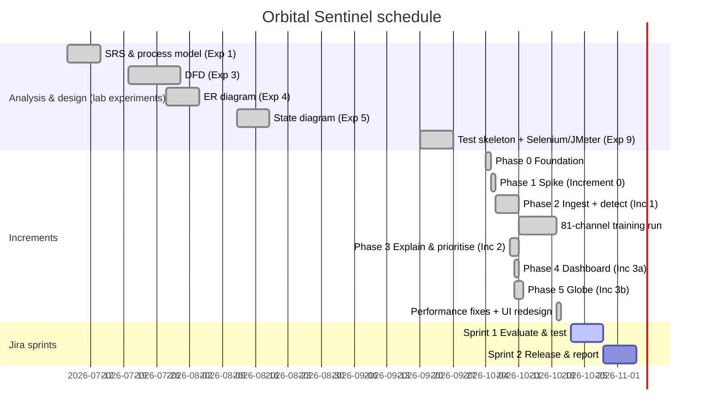

# Orbital Sentinel: Final Report Plan

**For:** the AI assistant drafting the final SE Lab report, and for Pushkar (who must do the steps that need his accounts, his screen and his voice).
**Read with:** `PROJECT_GUIDE.md` (all project facts, numbers, bug log, references). Section numbers like "Guide §12" point there.
**Date:** 21 October 2026.

---

## 0. Ground rules

1. **Honesty first.**
   - Use only numbers that exist in the repository or that the student measures and hands over.
   - Where a result is still pending (REQ-11, the Selenium and JMeter reruns), leave a clearly marked placeholder.
   - Never make up screenshots, test results, Jira history or dates.
2. **Jira history must be real.** Jira is compulsory but was not used during Phases 0–5. The report must say so (see Step B), and no sprint or burndown may be back-dated.
3. **Keep the traceability.** Use the ER entity names, the state-diagram state names and the REQ-n IDs exactly as they appear in the code and the SRS.
4. **Honest framing (SRS §5.2, §6).** The report must state three things: the system detects anomalies (it does not forecast), the telemetry is a replay, and it is a proof of concept.

---

## 1. What the professor asked for

**Report structure (given):**
- **Main report**
  1. Introduction
  2. Literature survey / existing system
  3. Software process model and project planning
  4. Requirements analysis
  5. System design
  6. Implementation
  7. Software tools used (at least three, with screenshots)
  8. Testing
  9. Results and discussion
  10. Conclusion and future enhancements
  11. References (IEEE)
- **Appendix A:** project links (GitHub repository, demo video on Drive)
- **Appendix B:** sample code listings (optional)

**Extra requirements given verbally:**
- **Jira is compulsory.**
- The report needs **functional and non-functional tests**, using Selenium, JMeter and so on.

**Submission checklist (given):**
- The GitHub repo is public (or shared with the faculty) and has a README with setup steps.
- The Drive video link opens in an incognito window without asking for access.
- At least three tools are shown with screenshots, purpose and usage.

---

## 2. Work order

Tasks marked **[S]** need the student: an account, a GUI, recording, or a judgement call. Tasks marked **[C]** are coding work on the repo.

| # | Step | Who | Depends on | Output |
|---|---|---|---|---|
| A1 | Run the REQ-11 persistence comparison (about 1 h CPU; close other heavy apps first) | C | — | `docs/results/phase3_persistence_comparison.md`, ADR 003 filled in, default N updated |
| A2 | Phase 6 essentials: README refresh, short in-app help, models as a GitHub Release, demo-mode replay | C | A1 | README, release asset |
| B | Jira project: backlog from the plan, bugs from the bug log, 2 real sprints for the remaining work | S (+C drafts the issue list) | — | Jira screenshots, Gantt from Jira Timeline |
| C | UML diagrams in StarUML from the specs in Step C | S | — | `.mdj` files + PNG exports |
| D1 | Add the new Selenium test cases (TC10–TC15) and the JMeter non-functional scenarios | C | — | updated `.side` / `.jmx` |
| D2 | Run Selenium IDE (Chrome + Firefox) and all JMeter scenarios; run Lighthouse and the FPS check | S | D1, A2 | screenshots, `.jtl` results, numbers |
| E | Tool screenshots (Jira, GitHub, StarUML, Selenium IDE, JMeter) | S | B, C, D2 | chapter 7 figures |
| F | Write the report chapters | C (draft) → S (review) | all above | report draft |
| G | Record the demo video, upload to Drive, test the link in incognito | S | A2 | Drive link |
| H | Make the repo public; final checks | S | F, G | submission |

Run Jira (B) and the diagrams (C) in parallel with A and D; they don't depend on each other.

---

## Step A: Finish the engineering the report depends on

**A1. REQ-11 comparison** (the headline result for chapter 9):
```powershell
cd backend
.venv\Scripts\python -m app.evaluation.reports --model-id MDL-LSTM-100-80 --sweep 1 2 3 5 8 --out ..\docs\results\phase3_persistence_comparison
```
Then:
- fill in `docs/adr/003-thresholds.md` with the chosen N, the with/without table, and the recall cost;
- set the seed default for `persistence_threshold` to the chosen N;
- check that the Evaluation page shows both rows.

**A2. Phase 6 essentials:**
- **README:** the status line is out of date. Add quick-start steps, the demo flow and the honest-framing note.
- **Models:** `models/` is not in git. Publish `MDL-LSTM-100-80` (about 29 MB) as a GitHub Release asset and document how to unpack it, so a cloned repo can run detection without training.
- **In-app help:** a small help panel (what the colours mean, how to read an explanation, the disclaimer) to satisfy SRS §2.6.
- **Demo mode (optional):** a replay that starts just before a known labelled anomaly, so the video shows an alert within seconds.

---

## Step B: Jira (compulsory)

### B.1 Setup
1. Create a free Atlassian account and a **Jira Software Cloud** site (the free plan allows up to 10 users).
2. Create a project using the **Scrum** template.
   - Name: *Orbital Sentinel*
   - Key: **OS** (issues become OS-1, OS-2, …)
3. **Optional but valuable:** install the **GitHub for Jira** app and connect `ItsPM25/Orbital_sentinel`.
   - From then on, every commit message that contains an issue key (e.g. `OS-23 Run the REQ-11 comparison`) appears in that issue's *Development* panel.
   - Use the key convention in every commit message from then on.
4. Add the professor or evaluator as a viewer if they want to inspect it live.

### B.2 How Jira maps to the project's process model

The SRS chose an **Incremental model with a prototype spike**. Jira models it directly:

| Process concept | Jira element |
|---|---|
| Increment (SRS) / Phase (`PHASES.md`) | **Epic** |
| Requirement REQ-n | **Story**, with the REQ ID in its summary and a label `REQ-n` |
| Engineering task | **Task** / sub-task |
| Defect (Guide §17 bug log) | **Bug** |
| Time-boxed chunk of remaining work | **Sprint** |
| Schedule (report §3.2) | **Timeline** view (a Gantt-style chart of the epics) |

**What the report should say:** Jira was adopted in the final increment. The earlier increments (Phases 0–5) were entered in Jira from the project plan (`docs/PHASES.md`) and the git history, so the whole project is traceable in one place. The remaining work (evaluation, testing, hardening, documentation) was planned and run as Jira sprints. This is true, and it still shows every Jira skill the course expects.

### B.3 Epics
| Epic | Content | Status |
|---|---|---|
| OS-E0 Foundation | repo, backend, DB schema, dataset script, CI | Done |
| OS-E1 Model-selection spike | candidate detectors, ADR 001/002 | Done |
| OS-E2 Ingestion + baseline detection | REQ-1 … REQ-6, REQ-18 (write) | Done |
| OS-E3 Explain & prioritise | REQ-7 … REQ-11 | Done (REQ-11 run in Sprint 1) |
| OS-E4 Dashboard & alerting | REQ-16 … REQ-18, roles | Done |
| OS-E5 Orbital tracking & 3D globe | REQ-12 … REQ-15 | Done |
| OS-E6 UI redesign & performance | shadcn UI, globe rebuild, CPU/SSE fixes | Done |
| OS-E7 Hardening, testing & release | Phase 6, test runs, README, release | Sprint 1–2 |
| OS-E8 Final report & demo | report, diagrams, video | Sprint 2 |

### B.4 Stories (one per requirement)

Each story gets the REQ ID, a one-line description, acceptance criteria taken from the SRS, and story points: 1, 2, 3, 5 or 8, by relative effort.
- **Already done (status Done, no sprint):** REQ-1 … REQ-10 and REQ-12 … REQ-18.
- **Done in Sprint 1:** REQ-11 ("Report FPR with vs without the persistence filter").

The non-functional requirements from SRS §5 are their own stories, for example *"NFR-Perf: score a window in ≤ 1 s"*, *"NFR-Sec: admin separated from analyst"*, *"NFR-Rel: malformed data never crashes a session"*. Each gets a linked test task in Sprint 1.

### B.5 Bugs

Create one **Bug** per row of Guide §17: B-01 … B-17 resolved (Done), plus O-01 and O-02 open.
- In each bug, record the symptom, the cause, the fix and the commit hash.
- Use the date found as a comment. Jira won't back-date the "created" field, and it shouldn't.
- This is the source of the report's **8.3 bug log**.

### B.6 Sprints (real, going forward)

| Sprint | Length | Goal | Issues |
|---|---|---|---|
| Sprint 1: Evaluate & test | about 1 week | Headline result + full test runs | REQ-11 run; ADR 003; new Selenium TCs; Selenium runs (Chrome, Firefox); JMeter load/stress/spike/soak; Lighthouse; FPS check; security and reliability drills; fix whatever breaks |
| Sprint 2: Release & report | about 1 week | Submittable package | README; models release; help panel; demo mode; StarUML diagrams; report chapters; demo video; repo public; final checklist |

Move each issue across the board (To Do → In Progress → Done) **as the work actually happens**. Close each sprint in Jira so the **Sprint Report** and **Burndown Chart** are genuine.

### B.7 Jira screenshots for the report
1. **Backlog:** epics panel open, stories with REQ IDs.
2. **Active sprint board** with issues in different columns.
3. **Timeline** view: the Gantt chart for report §3.2.
4. **One story's detail page:** acceptance criteria, points, and the linked commits in the Development panel (if GitHub is connected).
5. **Bug list:** a filter on `type = Bug`.
6. **Sprint Report and Burndown Chart** after Sprint 1 closes.

---

## Step C: System design diagrams (StarUML)

**Already exist:**
- ER diagram (Exp 4)
- DFD levels 0/1/2 (Exp 3)
- State transition diagram (Exp 5, StarUML)
- A simple use case diagram and component sketch in the SRS appendix (B.1, B.4)

Reuse them; they are traced in the code. **Redraw the use case diagram in StarUML** so all the diagrams match in style.

**Make in StarUML** (export each as PNG; keep the `.mdj`). Use the names below exactly; they match the code.

### C.1 Use case diagram (report §5.2)
- **Actors:** Analyst, Administrator, Evaluator (primary); CelesTrak (secondary, external system). Administrator generalises Analyst (it can do everything an Analyst can).
- **Use cases:**
  - Log in
  - View risk-ranked alerts
  - Acknowledge alert
  - Inspect satellite health
  - View telemetry chart
  - Track fleet on 3D globe
  - Change simulation speed
  - Start/stop monitoring session
  - Configure thresholds
  - Import dataset
  - View trained models
  - View accuracy metrics
  - Browse detection log
  - Fetch TLE data
- **Relationships:**
  - every use case except *Log in* «include»s *Log in*;
  - *Track fleet on 3D globe* «include»s *Fetch TLE data* (associated with CelesTrak);
  - *Inspect satellite health* «extend»s both *View risk-ranked alerts* and *Track fleet on 3D globe*;
  - *View telemetry chart* «extend»s *Inspect satellite health*.
- **Associations:**
  - Analyst: view alerts, acknowledge, inspect health, telemetry chart, globe, speed;
  - Administrator: start/stop, thresholds, import, models (plus everything an Analyst can do);
  - Evaluator: accuracy metrics, detection log, models, inspect health, view alerts.

### C.2 Class diagram (report §5.3)

**Domain classes** (attributes from Guide §11):
- Satellite, Channel, TelemetryReading, DetectionModel, Detection, Attribution, Alert, User, MonitoringConfig
- Enumerations: «enumeration» Role {Analyst, Administrator, Evaluator}, AlertStatus {AlertRaised, Acknowledged, Resolved}, SeverityLevel {LOW, MEDIUM, HIGH, CRITICAL}, DetectionOutcome {Suppressed, Confirmed}
- Multiplicities as in the ER diagram:
  - Satellite 1–* Channel; Channel 1–* TelemetryReading
  - Satellite 1–* Detection; DetectionModel 1–* Detection
  - Detection 1–* Attribution *–1 Channel
  - Detection 1–0..1 Alert; User 0..1–* Alert (acknowledges)
  - Satellite 1–* MonitoringConfig; User 1–* MonitoringConfig (sets)

**Pipeline classes:**

| Class | Members |
|---|---|
| «interface» Detector | `+score(window: TelemetryWindow): ChannelScores` |
| LstmDetector (realises Detector) | `-channels: Map<String,ChannelState>`, `+chan_ids()`, `+score()` |
| LstmPredictor | `-lstm: LSTM(2×80)`, `-head: Linear(80→10)`, `+forward(x)` |
| StreamingThreshold | `value_range`, `window=2100`, `+update(errors): StepDecision` |
| ReplaySource | `satellite_id`, `chan_ids`, `+windows(): Iterator<TelemetryWindow>`, `+length()` |
| Normaliser | `+fit()`, `+transform()` |
| Windower | `history=100`, `step=70`, `+starts(n)` |
| TelemetryWindow | `satellite_id`, `start_index`, `end_index`, `arrays`, `timestamp`, `malformed` |
| ChannelScores | `per_channel`, `satellite_score`, `threshold`, `is_anomaly`, `flagged_channels` |
| DetectionLifecycle | `persistence_n`, `+process_window(malformed, score, threshold): Outcome` |
| MonitoringSession | `satellite_id`, `model_id`, `persistence_n`, `severity_threshold`, `counters: SessionCounters`, `+run()`, `+run_async(windows_per_second)`, `+stop()`, `-process_window(window)` |
| SessionRegistry (`services/sessions.py`) | `+start_session()`, `+stop_session()`, `+list_running()` |
| EventBus (`services/events.py`) | `+subscribe()`, `+publish(event, satellite_id, data)` |
| «utility» Explain | `+attribute(scores): List`, `+compute_severity(score, persistence, threshold): (SeverityLevel, int)`, `+risk_label(risk): SeverityLevel`, `+rank_satellites(db): List<SatelliteRanking>` |
| «utility» CelesTrakClient | `+fetch_due(satellites)`, `+apply_fetched()`, `+tle_payload()` |

**Relationships:**
- MonitoringSession → Detector, ReplaySource, DetectionLifecycle (associations);
- LstmDetector ◇→ LstmPredictor (1 per channel) and StreamingThreshold (1 per channel);
- MonitoringSession ··> Explain, EventBus (dependencies).

### C.3 Sequence diagrams (report §5.4)
1. **Monitoring one window to an alert:**
   - Admin → Admin page → `POST /api/sessions` → SessionRegistry.start_session → creates MonitoringSession (asyncio task).
   - **loop** [each window, 1 s]:
     - ReplaySource.windows → LstmDetector.score (LstmPredictor + StreamingThreshold per channel) → DetectionLifecycle.process_window;
     - **alt** [Confirmed]: attribute → compute_severity → DB insert Detection, Attribution, Alert (or escalate the open Alert) → EventBus.publish(`alert.created`, `ranking`);
     - **else** [Suppressed]: DB insert Detection (Suppressed);
     - **else** [Normal]: counters++.
   - EventBus → `/api/stream` (SSE) → Dashboard → `GET /api/alerts` (coalesced) → table updates.
2. **Acknowledge an alert:**
   - Analyst → Dashboard → `POST /api/alerts/{id}/acknowledge` → `require_roles(Analyst, Administrator)`;
   - **alt** [allowed]: DB update status = Acknowledged, acknowledged_by, acknowledged_at → 200 AlertView → UI shows Acknowledged, button disabled;
   - **else** [Evaluator]: 403.
3. **Globe: track and inspect:**
   - Analyst → Globe page → `GET /api/tle` → CelesTrakClient.fetch_due → CelesTrak GP API;
   - **alt** [stale & not in backoff]: fetch, cache in DB;
   - **else**: cached/snapshot, marked stale;
   - → TLEs → browser: **loop** [every frame] satellite.js propagate → globe.gl objectsData;
   - Analyst clicks a satellite → camera flies to it → `GET /api/satellites/{id}/health` → detail panel.
4. **(Optional) Login:** form → `POST /api/login` → argon2 verify → signed httpOnly cookie → redirect to `/dashboard` → `GET /api/me`.

### C.4 Activity diagrams (report §5.4)
1. **Processing one telemetry window** (swimlanes Ingest / Detect / Explain / Store):
   - Receive window → *[malformed & gap > 5]* skip & count → End
   - → interpolate short gaps → score with the LSTM → smooth (EWMA) → dynamic threshold
   - → *[score ≤ 1]* count normal → *[N normal in a row]* close episode → End
   - → *[score > 1]* consecutive += 1 → *[count < N]* log Suppressed → End
   - → *[count ≥ N]* Confirmed → attribute channels → compute severity → *[open episode?]* escalate alert : raise new alert → publish events → End
2. **Analyst workflow:** Log in → view alerts → *[alert of interest]* open health panel → inspect chart and channel → acknowledge → *[more?]* loop → open globe → select satellite → review → log out.

### C.5 Architecture (report §5.1)
Draw a **UML component diagram**, or a deployment diagram, in StarUML from Guide §8.1:
- **Browser** (Next.js pages, globe.gl, satellite.js)
- **Next.js server** (`/api` rewrite)
- **FastAPI** (routers, MonitoringSession, pipeline, EventBus)
- **SQLite DB**, the `models/` folder, the `data/` folder
- **External:** CelesTrak

Label the interfaces HTTP/JSON, SSE and HTTPS. The mermaid diagram in Guide §8.1 can go into the report as-is too.

### C.6 Database design (report §5.5)
Reuse the Exp 4 ER diagram, plus a **table schema list** (Guide §11): the 11 physical tables, keys, the 1NF child tables, and the implementation-added columns with the reason for each.

### C.7 UI design (report §5.6)
Use screenshots of the redesigned UI (Guide §15.3), both light and dark, plus 2–3 sentences on the design approach (Guide §15.2). Wireframes in Figma are optional; the professor's TOC accepts "UI design / wireframes".

---

## Step D: Testing (functional + non-functional)

### D.1 Test strategy (report §8.1)

| Level / type | Tool | What | Status |
|---|---|---|---|
| Unit | pytest | Every pipeline stage with mocks: ingest, threshold, all 19 lifecycle transitions, attribution, severity, ranking, metrics, tracking | 219 tests pass (DONE) |
| Integration / API | pytest + FastAPI TestClient | Every endpoint, every role (403s), session pipeline on fixtures | DONE (inside the 219) |
| Functional UI (E2E) | **Selenium IDE** | TC01–TC09 existing + TC10–TC15 new | run PENDING |
| Accuracy | evaluator CLI | Baseline (DONE, F1 0.683) and REQ-11 with/without | REQ-11 PENDING |
| Performance: load | **JMeter** | 50 users, normal load | run PENDING |
| Performance: stress / spike / soak | **JMeter** | find the limits and check stability | PENDING |
| Performance: front end | Chrome DevTools (FPS meter), **Lighthouse** | globe frame rate; page performance, accessibility | PENDING |
| Security | pytest + JMeter/curl + DevTools | role enforcement, cookie flags, no secrets in responses | partly DONE |
| Reliability | manual drills + pytest | network off, malformed data, API restart | partly DONE |
| Compatibility | Selenium IDE in Chrome and Firefox | same suite on two browsers | PENDING |
| Portability | GitHub Actions | Ubuntu + Windows | configured; check the Actions tab |

### D.2 Functional test cases (Selenium IDE)

**Existing (Guide §16.2):**
- TC01 Login OK
- TC02 Wrong password
- TC03 Empty fields
- TC04 Risk order
- TC05 Acknowledge
- TC06 Logout + access control
- TC07 Analyst blocked from admin
- TC08 Drill-down
- TC09 Globe click → panel

**To add [C]** (all keep using stable element IDs):

| ID | Test | Steps | Expected |
|---|---|---|---|
| TC10 | Analyst sees no admin link | log in as analyst → read the sidebar | no "Administration" link; Admin user does see it |
| TC11 | Admin starts and stops monitoring | admin → /admin → click `#session-toggle-SAT-001` → wait → click again | `#session-status-SAT-001` shows "Running" (with counters), then "Stopped" |
| TC12 | Monitoring config is saved | admin → change `#persistence-SAT-001` to 4 → `#save-config-SAT-001` | toast "Saved monitoring config for SAT-001"; value persists after reload |
| TC13 | Evaluation outcome filter | evaluator → /evaluation → click "Confirmed" | every row's outcome cell = Confirmed |
| TC14 | Satellites overview lists the fleet | open /satellites | 5 rows; `#satellite-SAT-001` present |
| TC15 | Globe speed control | open /globe → click "Live" | the caption above `#simClock` reads "Live, UTC" (give that caption an id when scripting) |

Use the table format the professor gave for **8.2**: ID, input, expected output, actual output, status. Fill in "actual" and "status" only from the real runs.

### D.3 Non-functional tests

| ID | Type | Tool / method | Configuration | Pass criterion (from SRS §5 or set here) |
|---|---|---|---|---|
| NFT-01 | Load | JMeter (existing plan) | 50 users, 10 s ramp, 10 loops (2,500 requests) | 0% errors; GET average < 1 s |
| NFT-02 | Stress | JMeter `-Jusers=100/200/400 -Jrampup=30` | step the users up | report the user count where errors or the 90th percentile climb; expect login (argon2) to be the bottleneck |
| NFT-03 | Spike | JMeter | 200 users, 1 s ramp | system recovers; errors reported honestly |
| NFT-04 | Endurance (soak) | JMeter, duration-based thread group | 20 users for 10 min | no rising latency; backend memory steady (watch Task Manager) |
| NFT-05 | Response time per endpoint | JMeter Aggregate Report | include `GET /api/satellites/SAT-001/telemetry?channel=A-1` and `/api/tle` | typical < 1 s |
| NFT-06 | Detection latency | Admin page counters | SMAP session running | last and max scoring ms ≤ about 1,000 ms (SRS §5.1) |
| NFT-07 | Globe frame rate | Chrome DevTools → Rendering → FPS meter | /globe at 60×, 5 satellites | steady near the display refresh rate on the laptop |
| NFT-08 | Front-end quality | Lighthouse (DevTools) on /login, /dashboard | desktop | report the Performance, Accessibility and Best Practices scores |
| NFT-09 | Security: roles | pytest (existing) + JMeter/curl with the analyst cookie on `POST /api/sessions` | — | 403 |
| NFT-10 | Security: session cookie | DevTools → Application → Cookies | — | `os_session` is HttpOnly; no password or hash in any API response |
| NFT-11 | Reliability: offline | disable the network, open /globe | — | globe still renders; "using cached TLEs" note |
| NFT-12 | Reliability: malformed data | pytest `test_ingest` (NaN, inf, gaps) | — | session never stops (DONE) |
| NFT-13 | Compatibility | Selenium IDE suite in Chrome and Firefox | — | same pass/fail in both |
| NFT-14 | Portability | GitHub Actions matrix | Ubuntu + Windows | green |
| NFT-15 | Usability (light check) | 3 classmates find the riskiest satellite and acknowledge its alert unaided | — | completion and time noted |

**JMeter notes [C prepares]:**
- Add a telemetry sampler and a TLE sampler.
- Add a separate read-only thread group without the per-loop login, so argon2 cost does not hide GET latency.
- Add a duration-based soak variant.
- Run headless with HTML reports, so the report gets clean charts:

```
jmeter -n -t testing/OrbitalSentinel.jmx -Jusers=50 -Jrampup=10 -Jloops=10 -l results/load.jtl -e -o results/load-report
```

**Before any run:**
- close Selenium IDE when you're not testing, and other heavy apps;
- use the production build (`npm run build && npm run start`);
- open `http://localhost:3001/api/reset`.

Record the laptop specs in the report: i5-13420H, 12 logical CPUs, 16 GB RAM.

### D.4 Results and bug log (report §8.3)
- Results tables come from the JMeter Aggregate/Summary Reports and the HTML dashboard, the Selenium IDE run log, and Lighthouse.
- The **bug log** is the Jira bug list (Guide §17), with defects found during D2 added. The point to make: testing found real defects, such as B-11 (blank globe), B-14 and B-16 (test reset and race), and B-13 and B-15 (wrong label, hidden spikes).

---

## Step E: Tools chapter (report §7)

At least three tools are required. Use **five**, with Jira as a must.

| Tool | Purpose | SDLC phase | Usage in this project | Screenshots |
|---|---|---|---|---|
| **Jira Software** | Project management | Planning, tracking (all phases) | Epics = increments, stories = REQ-n, bugs = defect log, 2 sprints, timeline = Gantt | backlog, board, timeline, burndown, bug list |
| **Git + GitHub** (+ Actions) | Version control, CI | Implementation, maintenance | 26+ commits; CI runs lint/tests/build on Ubuntu + Windows; Jira linked | commit history, repo page, Actions run, Release |
| **StarUML** | UML modelling | Design | Use case, class, sequence, activity, component diagrams (and the Exp 5 state diagram) | each diagram open in StarUML |
| **Selenium IDE** | Functional UI testing | Testing | 15 test cases, Chrome + Firefox | suite passing, one test's log, the app under test |
| **Apache JMeter** | Load / performance testing | Testing | Load, stress, spike, soak scenarios | test plan tree, Summary/Aggregate Report, HTML dashboard graph |

**Optional extras** for the summary table only: pytest (unit/integration), Chrome DevTools/Lighthouse, VS Code, PyTorch.

For each of the five tools, write:
- what it is;
- why it was chosen;
- how it was used here, with concrete numbers;
- 1–3 screenshots with captions ("Figure 7.x — …").

---

## Step F: The report, chapter by chapter

| Report section | Write from | Notes |
|---|---|---|
| **1.1 Background / motivation** | Guide §3; SRS §1 | — |
| **1.2 Problem statement** | Guide §3 | — |
| **1.3 Objectives** | Guide §4 | numbered list |
| **1.4 Scope and limitations** | Guide §2 (what it is not), §5 | include the honest-framing statement |
| **2.1 Existing systems** | the categories below | verify every citation before use |
| **2.2 Gaps + proposed solution** | Guide §2, §10.5 | the gap: no tool joins detection + explanation + prioritisation + live tracking |
| **3.1 SDLC model** | Guide §7; SRS §2–4 | Incremental + Prototype spike, with the reasons; Jira as the tracking tool (honest wording, Step B.2) |
| **3.2 Schedule** | Jira Timeline screenshot + the gantt below (real dates) | — |
| **3.3 Risk analysis** | the table below | — |
| **3.4 Effort estimate (optional)** | the COCOMO note below | — |
| **4.1 Functional requirements** | Guide §6.1 | REQ table with status |
| **4.2 Non-functional requirements** | Guide §6.2 | — |
| **4.3 SRS summary** | SRS; Guide §6.3–6.4 | roles, TBDs closed |
| **4.4 Hardware/software requirements** | Guide §14.1, §15.1, §20 | the laptop as the reference machine |
| **5.1 Architecture** | Guide §8 + C.5 | — |
| **5.2–5.4 UML** | Step C diagrams | — |
| **5.5 ER / DB** | Exp 4 ER + Guide §11 | — |
| **5.6 UI** | screenshots + Guide §15.2 | — |
| **6.1 Technology stack** | Guide §14.1, §15.1 | — |
| **6.2 Module description** | Guide §8.3, §10, §13, §14, §15 | one paragraph per module |
| **6.3 Key code snippets** | `LstmPredictor` class; `compute_severity`; `attribute`; the dynamic threshold's ε search loop; the globe frame loop; `require_roles` | short, under 25 lines each |
| **7 Tools** | Step E | — |
| **8 Testing** | Step D + Guide §16, §17 | — |
| **9.1 Output screenshots** | login, dashboard, globe (with a selected satellite), health panel chart, evaluation, admin with a running session | light + dark |
| **9.2 Analysis vs objectives** | per objective: met / partly met, with the numbers | F1 0.683; REQ-11 result; latency; attribution 15/17; test results |
| **10 Conclusion + future work** | Guide §21 + ideas below | — |
| **References** | Guide §24 | IEEE format, verified only |
| **Appendix A** | GitHub URL, Drive video URL | test both in incognito |
| **Appendix B (optional)** | longer code listings | — |

**2.1 Existing systems (verify each before citing):**
- Mission-control telemetry tools that use **fixed limit checks** (out-of-limits alarms). NASA's open-source **Open MCT** is a visualisation framework with no learned detection.
- Research detectors: **Telemanom** (Hundman et al. 2018, LSTM + dynamic threshold, code only, no operator UI); **OmniAnomaly** (Su et al., KDD 2019, multivariate stochastic RNN); autoencoder and Isolation Forest baselines.
- Satellite trackers: **CelesTrak**, **N2YO**, **Heavens-Above** show positions but nothing about health.
- **Gap:** no tool joins learned detection, per-channel explanation, false-alarm filtering, fleet risk ranking and live orbital situational awareness in one honest, explainable interface.

**3.2 Gantt (real dates; render as mermaid or redraw):**

Which dates are exact:
- **Exact:** the end dates of Exp 1, 4 and 5 (the dates on those documents: 14 Jul, 4 Aug, 19 Aug), and each phase's end date (its git commit date).
- **Approximate:** all start dates, and the Exp 3 and Exp 9 dates.

Replace the sprint dates with the real ones once the sprints are created in Jira.

**3.3 Risk analysis (planned risks and what actually happened):**

| Risk | Likelihood / impact | Mitigation | What happened |
|---|---|---|---|
| LSTM does not beat simple baselines | M / H | Phase 1 spike compared 5 candidates first | LSTM won clearly (F1 0.79 vs 0.51 floor) |
| CPU training too slow | M / M | small model (100/80), resumable training | took about 6 h because another app hogged the CPU; finished |
| CelesTrak unavailable | M / M | 2 h cache, backoff, bundled snapshot | happened (TLS timeouts); the globe kept working after fix B-07 |
| Only 2 spacecraft in the dataset | certain / M | proxy satellites, clearly labelled (ADR 004) | applied |
| Tuning on test data inflates metrics | M / H | split tuning/reporting halves | spike number was optimistic; re-measured honestly (0.683) |
| SQLite write contention | L / M | WAL, short writes | happened (B-08); fixed |
| Laptop performance during the demo | M / H | paced replay, production build | fixed (B-09) |
| Deadline | H / H | incremental delivery, demo-able core first | core done before the UI polish |

**3.4 Effort (optional, basic COCOMO, organic mode):**
- Delivered source is about 8.9 KLOC (backend about 4.0 + frontend about 4.2 + spike about 0.7, excluding tests and generated UI code).
- Effort = 2.4 × 8.9^1.05 ≈ **23.8 person-months**.
- Time = 2.5 × 23.8^0.38 ≈ **8.3 months**.
- The actual effort was far lower: one student over about 3.5 months including the lab documents. COCOMO's 1980s calibration assumes no reuse; this project leans on large libraries (PyTorch, FastAPI, Next.js, globe.gl).
- Present this as an illustration of the method, not a claim.

**10 Future enhancements:**
- a relative error guard (fixes O-01);
- a continuing replay clock (O-02);
- the inverted-error pass and horizon averaging from Telemanom, to lift recall;
- a transformer-based detector;
- real multi-channel joint attribution on a satellite with genuinely coupled channels;
- integration with a real operator feed;
- Postgres and multi-user deployment;
- e-mail/SMS alert notification;
- edge deployment (on-board inference).

---

## Step G: Demo video (3–5 minutes)

**Record:** Win + Alt + R (Xbox Game Bar) or OBS, at 1080p, with a voice-over.
**Before recording:**
- production build;
- `/api/reset`;
- close other apps;
- light theme (it reads better on video).

| Time | Show | Say (short) |
|---|---|---|
| 0:00 | Login page | The problem; what the system is and isn't (replay, proof of concept) |
| 0:25 | Administration → Start SMAP and Aqua | 1 window per second; per-channel LSTMs scoring live |
| 0:50 | Alerts dashboard updating live | Risk ranking, severity, attributed channel; acknowledge one alert |
| 1:40 | Health panel of the top satellite | Telemetry chart with the flagged range shaded; attributed channels |
| 2:20 | Globe: rotate; click SMAP | Real positions from CelesTrak + SGP4; 60× clock; detail panel numbers (98-min orbit, 7.5 km/s) |
| 3:10 | Evaluation page | F1 0.683 on 81 channels; REQ-11 with/without the filter [once run] |
| 3:40 | Jira board + GitHub Actions (quick) | Process and CI |
| 4:00 | Close | Limitations and future work |

**Upload:**
1. Upload to Google Drive → Share → General access: **Anyone with the link: Viewer**.
2. Open the link in an incognito window to confirm it plays without a sign-in.

---

## Step H: Final checklist

- [ ] REQ-11 numbers in ADR 003, the report and the Evaluation page
- [ ] README current: setup, dataset, models release, run, demo flow, honest framing
- [ ] Models published as a GitHub Release; README explains how to use them
- [ ] GitHub repo **public** (or shared with the faculty); the CI badge or Actions tab is green
- [ ] Jira: epics, stories with REQ IDs, bugs, 2 closed sprints with real burndown; timeline screenshot
- [ ] StarUML: use case, class, sequence (2–3), activity (1–2), component diagrams exported
- [ ] Selenium IDE suite run in Chrome and Firefox, with screenshots; results in the 8.2 table
- [ ] JMeter NFT-01 … NFT-05 run; HTML report screenshots; results in 8.3
- [ ] Lighthouse + FPS + security + offline drills recorded
- [ ] At least 3 tools (5 planned) with purpose, usage and captioned screenshots
- [ ] Demo video on Drive; link works in incognito
- [ ] References verified; IEEE format
- [ ] Appendix A links tested
- [ ] AI-assistance disclosure handled per the course policy
- [ ] Every number in the report traceable to the repo or to a recorded run
